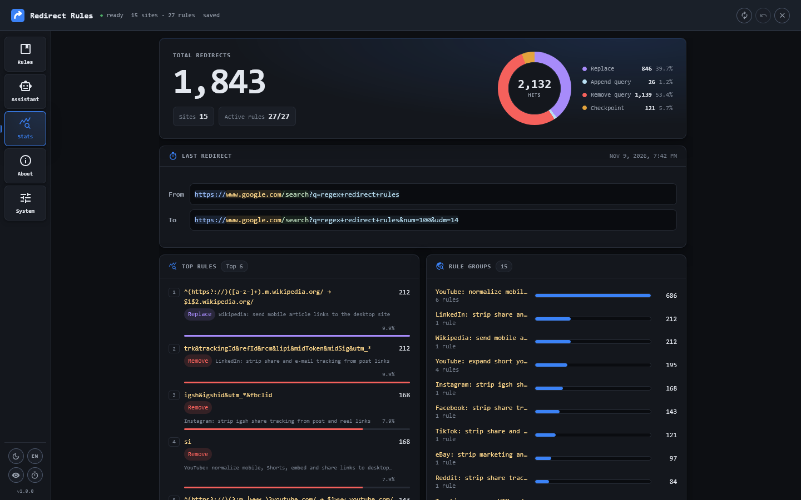

<h1 align="center"> Redirect Rules</h1>

> Regex-based URL rewriting for every page — as the page loads, before it renders.

<div align="center">

[](https://github.com/JanGaida/redirect-rules/releases)
[](https://github.com/JanGaida/redirect-rules/actions/workflows/ci.yml)
[](LICENSE)

</div>

<p align="center">
  
</p>

Redirect Rules is a Tampermonkey userscript that rewrites URLs through regex rules — no per-site UI, no proxy, and no UI injected into the pages it rewrites. You describe a rewrite once; the engine applies it at `document-start` on every page, follows SPA navigation, and leaves fragments and raw query encodings alone.

Rules live in **site groups**: a `siteRegex` gate decides which URLs a group applies to, and that group's ordered rules run against them. Four rule kinds cover the common cases — `replace`, `appendQuery`, `removeQuery`, and `checkpoint`.

## What you can do with it

- **Open clean links** — strip `utm_*`, `fbclid`, `gclid`, and other ad or share IDs before the page loads.
- **Skip wrappers** — send Google AMP, YouTube Shorts/embed, and `m.` subdomains to their canonical URLs.
- **Enforce your defaults** — 100 results and the Web filter on Google, desktop pages from mobile links, your language everywhere.

## Install

[](https://github.com/JanGaida/redirect-rules/releases/latest/download/redirect-rules.user.js)

1. Install [Tampermonkey](https://www.tampermonkey.net/) — the only prerequisite.
2. Click the install button above and confirm the prompt.
3. Open **Redirect Rules → Open Dashboard** from the Tampermonkey menu and enable the example groups you want.

**Nothing is rewritten until you enable a group.** Every shipped example group starts disabled, so a fresh install never changes a request.

Updates install themselves from the latest GitHub release. A dev build (`npm run build:dev`) carries no update or download URL and stays installed until you reinstall the prod build.

## Quick start

1. **Add site rule** — enter the URLs the group should touch as `siteRegex`, e.g. `/^https?:\/\/(?:www\.)?example\.com\//`.
2. Add a rule row and pick the kind. `replace` takes a regex and a substitution, `appendQuery` a `k=v&k2=v2` list, `removeQuery` a key list, `checkpoint` a regex plus `continue`/`stop`.
3. Add a preview entry with a test URL. The preview replays the whole group chain and shows the result; a filled expected output turns the entry into a test.
4. Reorder rows with the grip — drag with mouse or finger, or press Arrow Up/Down on the focused grip.
5. Autosave persists after 1 s / 2 s / 5 s (rail stopwatch). Close or ESC flushes immediately.

## Rule model

| Kind          | Behavior                                                                                                   |
| ------------- | ---------------------------------------------------------------------------------------------------------- |
| `replace`     | Standard `String.replace` semantics (`$&`, `$1`, …). `/pattern/flags` or a literal.                        |
| `appendQuery` | Appends or overwrites params (`k=v&k2=v2`); picks `?`/`&`, never touches the fragment, no re-encoding.     |
| `removeQuery` | Removes params by key (`utm_*&fbclid`); a trailing `*` is a prefix wildcard.                               |
| `checkpoint`  | Tests the current URL without changing it — `continue` requires a match, `stop` ends the group on a match. |

The site gate is evaluated once per URL; matched groups run their rules in order. An authored `" "` or `\s` matches both the raw and the `%20` form. Query kinds match against the decoded query while edits keep the raw encoding.

## Example rules

Four of the fifteen shipped groups, as entered in the editor:

**Wikipedia — mobile links to the desktop site**

```text
Site gate:    /^https?:\/\/([a-z-]+)\.m\.wikipedia\.org\//
Kind:         replace
Regex:        /^(https?:\/\/)([a-z-]+)\.m\.wikipedia\.org\//
Substitution: $1$2.wikipedia.org/
```

**Google Search — 100 results with the Web filter**

```text
Site gate: /^https?:\/\/(?:www\.)?google\.[a-z]{2,3}(?:\.[a-z]{2,3})?\/search\?/
Kind:      appendQuery
Params:    num=100&udm=14
```

**Tracking — strip ad and share IDs on any host**

```text
Site gate: /[?&](?:utm_|fbclid|gclid|gbraid|wbraid|dclid|msclkid|yclid|srsltid)/   (content gate)
Kind:      removeQuery
Keys:      utm_*&fbclid&gclid&gbraid&wbraid&dclid&msclkid&yclid&mc_cid&mc_eid&mkt_tok
           &igshid&twclid&srsltid&_openstat&ref_src&ref_url
```

**YouTube — canonicalize Shorts, embed, and mobile links**

```text
Site gate: /^https?:\/\/(?:www\.|m\.)?youtube\.com\//
Rules:     removeQuery  si
           replace      /^(https?:\/\/)(?:m\.|www\.)?youtube\.com\//       →  $1www.youtube.com/
           checkpoint   /^https?:\/\/www\.youtube\.com\/watch\?/            →  stop
           replace      /\/shorts\/([A-Za-z0-9_-]+)\/?\?/                  →  /watch?v=$1&
           replace      /\/embed\/([A-Za-z0-9_-]+)\/?\?/                   →  /watch?v=$1&
           replace      /\/(?:shorts|embed)\/([A-Za-z0-9_-]+)\/?(#.*)?$/   →  /watch?v=$1$2
```

The shipped groups cover media, search, shopping, social, and tracking cleanup. All of them start disabled — enable them in the Rules tab or write your own.

## The dashboard

<p align="center">
  
</p>

- **Rules** — explorer, editor dock, live validation with a two-sided before/after preview, the full chain, and group test cases.
- **Assistant** — copies a prompt for any LLM (plus the selected group), links to popular chat UIs, and imports the JSON answer by matching its gate to a group or creating one; existing rules are reported instead of duplicated. No API key, no model calls.
- **Stats** — per-rule counters, total redirects, last redirect, and the kind distribution.
- **Info** — installed version, links, and the changelog embedded at build time.
- **System** — language, theme, motion, console verbosity, autosave speed, and export/import.

Selection, group on/off, undo, multi-tab sync, and keyboard-reachable actions work throughout. The dashboard is a separate takeover tab, so editing never touches the page it was opened from.

## Compatibility & privacy

- Runs on all `http(s)` pages at `document-start`; SPA navigation is followed through `pushState` and `popstate` (`replaceState` is deliberately not patched).
- Rewrites URLs only — no UI is injected into the pages being rewritten.
- Fragments, raw query encodings, and non-matching URLs are left untouched. A per-tab loop guard stops A→B→A oscillations with a console error.
- No telemetry. The engine runs locally; settings and counters live only in Tampermonkey's storage. The dashboard additionally fetches the inert host stub from GitHub raw and the Hack font from jsDelivr — static assets that carry no page data.
- **Console logs:** the default `info` level prints each applied redirect's source and target URL, including query strings. Use `warn`/`silent` or Performance mode to keep the console quiet.
- Tampermonkey is the supported script manager; Firefox is the reference browser of the automated suite. Other managers and Chromium-based browsers are not covered by the test suite.
- Only import rules you trust. A malicious or catastrophic regex runs synchronously and can block the page.

## Troubleshooting

- **Dashboard tab stays blank** — the host stub is fetched from GitHub raw; without that request the tab has nothing to boot from. Retry with network access.
- **A rule keeps aborting** — the loop guard caught an A→B→A oscillation for that tab. Fix the rule pair instead of reloading.
- **SPA sites that navigate via `replaceState`** — those transitions do not re-trigger the engine, by design.
- **Two rewriters fight** — coexistence with other URL-rewriting scripts is not guaranteed.
- **Auto-update does nothing** — updates come from the latest published release; a dev build has no update URL.
- **Close is refused** — some engines block `window.close()` for tabs they did not open; the dashboard then shows a close-it-manually hint.

## Development

Node.js `^20.19.0 || >=22.12.0` (Vite 8).

```bash
npm install
npm run build        # → dist/redirect-rules.user.js
npm run check        # svelte-check + tsc
npm test             # Vitest
npm run test:e2e     # Playwright (Firefox) against synthetic fixtures — build first
npm run screenshots  # regenerate the README screenshots — build first
```

`npm run install:prod` builds the artifact, serves it locally, and opens the Tampermonkey install page. `npm run install:dev` installs a readable dev build that replaces the prod script.

CI runs `check`, `test`, `comments:check --strict`, `css:check --strict`, `docs:check`, `release:check`, `format:check`, and `build`; a second job runs the E2E suite. The fixture pages are committed and contain no personal data, so E2E needs no live-site dependency.

Setup details, architecture, and conventions: [CONTEXT.md](CONTEXT.md) and [docs/architecture/](docs/architecture/INDEX.md). Release history: [CHANGELOG.md](CHANGELOG.md).

### Tech stack

| Tool                                                                                              | Purpose                                       | License    |
| ------------------------------------------------------------------------------------------------- | --------------------------------------------- | ---------- |
| [Svelte 5](https://svelte.dev/)                                                                   | Dashboard UI                                  | MIT        |
| [TypeScript](https://www.typescriptlang.org/)                                                     | Type safety across the codebase               | Apache-2.0 |
| [Vite](https://vitejs.dev/) + [vite-plugin-monkey](https://github.com/lisonge/vite-plugin-monkey) | Bundle the userscript and its metadata header | MIT        |
| [Vitest](https://vitest.dev/)                                                                     | Unit tests                                    | MIT        |
| [Playwright](https://playwright.dev/)                                                             | E2E tests and screenshot capture (Firefox)    | Apache-2.0 |

### Contributing

`main` is protected; changes land through squash-merged PRs with Conventional Commit titles. Run the gates above before opening one.

## License

[GPL-3.0](LICENSE) © 2026 Jan Gaida
