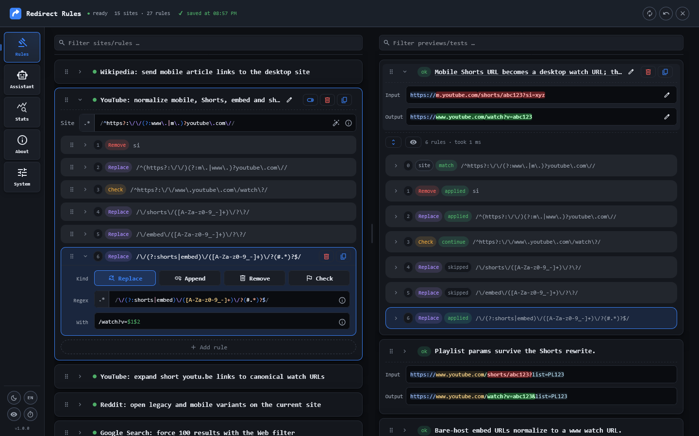
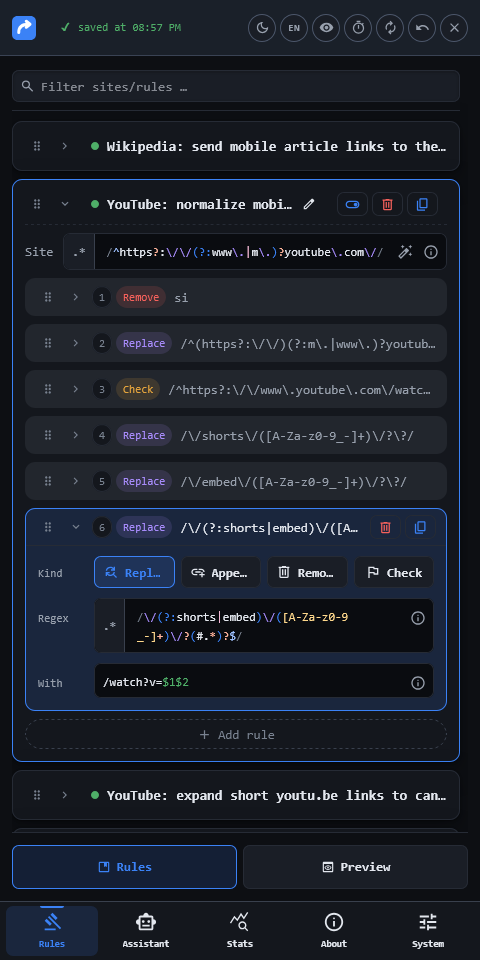

<h1 align="center"> Redirect Rules</h1>

<div align="center">

[](https://github.com/JanGaida/redirect-rules/releases)
[](https://github.com/JanGaida/redirect-rules/actions/workflows/ci.yml)
[](LICENSE)

</div>

> Regex-based URL rewriting for every page — before it renders.

<p align="center">
  
  &nbsp;&nbsp;
  
</p>

A Tampermonkey userscript that rewrites URLs through regex rules at `document-start`, follows SPA navigation, and leaves fragments and raw query encodings alone.

## ✨ Features

- **Site groups** — a `siteRegex` gate selects the URLs a group applies to.
- **Ordered rule chains** — each group runs its rules in order.
- **Four rule kinds** — `replace`, `appendQuery`, `removeQuery`, and `checkpoint`.
- **Live validation** — invalid regexes are flagged and never saved.
- **Phone layout** — the dashboard adapts down to 320px.
- **Assistant** — copy an LLM prompt for a group, then import its JSON answer. No API key.
- **Stats & transfer** — per-rule counters plus settings export/import.

## ⚡ Install

&nbsp;&nbsp;[](https://github.com/JanGaida/redirect-rules/releases/latest/download/redirect-rules.user.js)

**Requires [Tampermonkey](https://www.tampermonkey.net/).**

1. Click the install button above.
2. In the Tampermonkey menu, select **Redirect Rules: Open Dashboard**.
3. Enable the groups you want.

## 🚀 Quick start

1. Click **Add site rule** and set the **Site regex**.
2. Click **Add rule** and pick a kind.
3. Click **Add preview URL** and enter a test URL — the preview replays the chain.
4. Drag the grip to reorder; autosave saves after 1–5 s.

## 🧩 Rule model

| Kind          | Behavior                                                                                      |
| ------------- | --------------------------------------------------------------------------------------------- |
| `replace`     | `String.replace` semantics; `/pattern/flags` or a literal.                                    |
| `appendQuery` | Merges params (`k=v&k2=v2`); keeps the fragment and raw encoding.                             |
| `removeQuery` | Removes keys (`utm_*&fbclid`); a trailing `*` is a prefix wildcard.                           |
| `checkpoint`  | Tests without changing the URL; `continue` needs a match, `stop` skips the rest of the chain. |

The gate runs once per URL; rules run in order. `" "`/`\s` matches both raw and `%20`; query matching is decoded, edits keep raw encoding.

## 📌 Examples

**Wikipedia — mobile links to the desktop site**

```text
Site gate:    /^https?:\/\/([a-z-]+)\.m\.wikipedia\.org\//
Kind:         replace
Regex:        /^(https?:\/\/)([a-z-]+)\.m\.wikipedia\.org\//
Substitution: $1$2.wikipedia.org/
```

**Google Search — 100 results with the Web filter**

```text
Site gate: /^https?:\/\/(?:www\.)?google\.[a-z]{2,3}(?:\.[a-z]{2,3})?\/search\?/
Kind:      appendQuery
Params:    num=100&udm=14
```

**Tracking — strip ad and share IDs on any host**

```text
Site gate: /[?&](?:utm_|fbclid|gclid|gbraid|wbraid|dclid|msclkid|yclid|srsltid)/   (content gate)
Kind:      removeQuery
Keys:      utm_*&fbclid&gclid&gbraid&wbraid&dclid&msclkid&yclid&mc_cid&mc_eid&mkt_tok
           &igshid&twclid&srsltid&_openstat&ref_src&ref_url
```

**YouTube — canonicalize Shorts, embed, and mobile links**

```text
Site gate: /^https?:\/\/(?:www\.|m\.)?youtube\.com\//
Rules:     removeQuery  si
           replace      /^(https?:\/\/)(?:m\.|www\.)?youtube\.com\//       →  $1www.youtube.com/
           checkpoint   /^https?:\/\/www\.youtube\.com\/watch\?/           →  stop
           replace      /\/shorts\/([A-Za-z0-9_-]+)\/?\?/                  →  /watch?v=$1&
           replace      /\/embed\/([A-Za-z0-9_-]+)\/?\?/                   →  /watch?v=$1&
           replace      /\/(?:shorts|embed)\/([A-Za-z0-9_-]+)\/?(#.*)?$/   →  /watch?v=$1$2
```

## 🔒 Privacy & compatibility

- Runs on `http(s)` at `document-start`; follows `pushState`/`popstate` (not `replaceState`).
- No page UI, no telemetry; settings and stats stay in Tampermonkey storage. The dashboard fetches the host stub from GitHub raw and the Hack font from jsDelivr — static assets only.
- Console `info` logs redirect URLs — use `warn`/`silent` to quiet it.
- Tampermonkey and Firefox are the tested path; other managers and browsers are not covered.
- A bad regex runs synchronously and can block the page.

## 🧰 Tech stack

| Tool                                                                                              | Purpose                                       | License    |
| ------------------------------------------------------------------------------------------------- | --------------------------------------------- | ---------- |
| [Svelte 5](https://svelte.dev/)                                                                   | Dashboard UI                                  | MIT        |
| [TypeScript](https://www.typescriptlang.org/)                                                     | Type safety across the codebase               | Apache-2.0 |
| [Vite](https://vitejs.dev/) + [vite-plugin-monkey](https://github.com/lisonge/vite-plugin-monkey) | Bundle the userscript and its metadata header | MIT        |
| [Vitest](https://vitest.dev/)                                                                     | Unit tests                                    | MIT        |
| [Playwright](https://playwright.dev/)                                                             | E2E tests and screenshot capture (Firefox)    | Apache-2.0 |

## 🛠️ Development

Node.js `^20.19.0 || >=22.12.0`.

```bash
npm install
npm run build        # → dist/redirect-rules.user.js
npm run check        # svelte-check + tsc
npm test             # Vitest
npm run test:e2e     # Playwright (Firefox) — build first
npm run screenshots  # regenerate README shots — build first
```

Details: [CONTEXT.md](CONTEXT.md) · [architecture](docs/architecture/INDEX.md) · [changelog](CHANGELOG.md).

CI runs `check`, `test`, `comments:check`, `css:check`, `docs:check`, `release:check`, `format:check`, `build`, plus E2E.

## 📄 License

[GPL-3.0](LICENSE) © 2026 Jan Gaida
