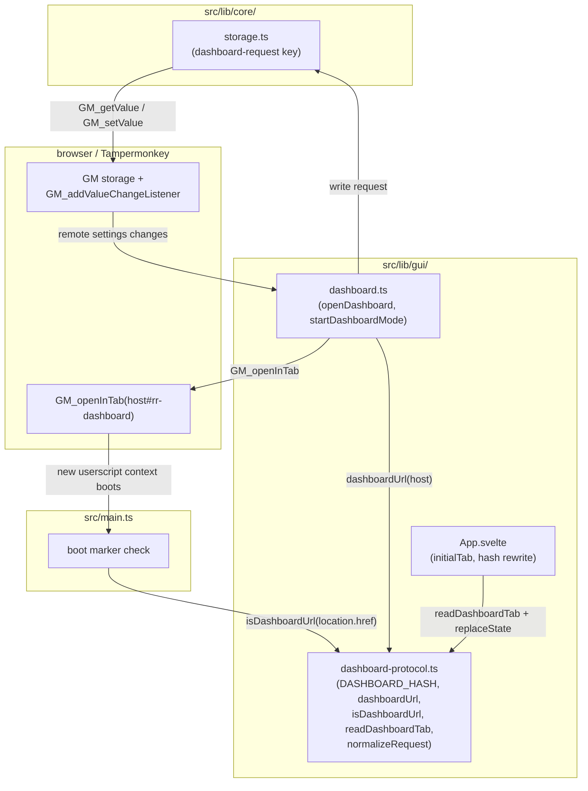
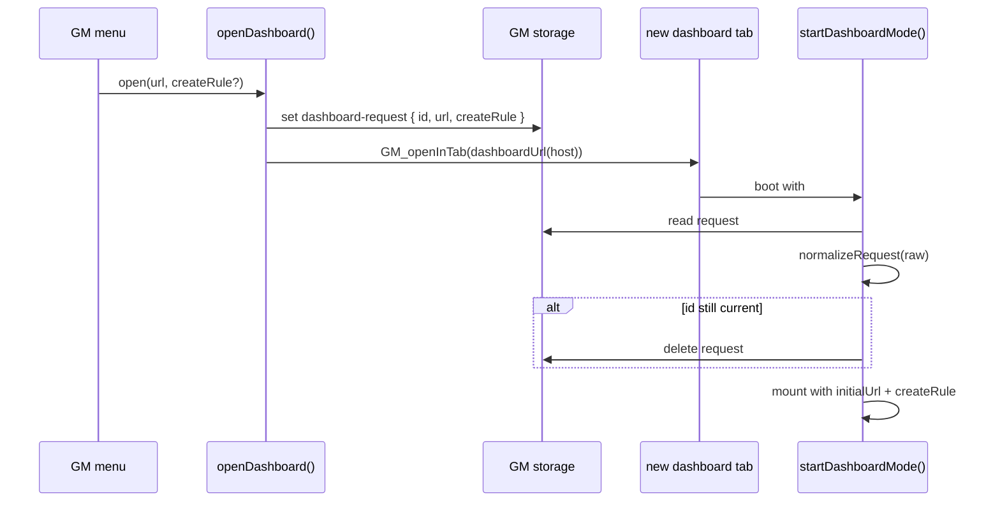
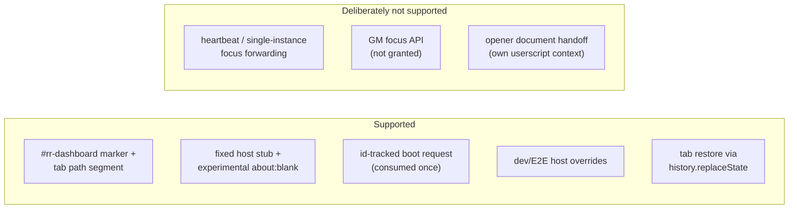

# Architecture: Dashboard Protocol

> Pure marker, host, and boot-request helpers that connect the Tampermonkey menu to a
> hash-takeover dashboard tab. Diagrams depict relationships, structure, and boundaries — no
> implementation details.

## Component Structure

## Marker and Tab Encoding

- `DASHBOARD_HASH` is `rr-dashboard`. A URL is a dashboard URL when its fragment equals the
  marker or starts with `rr-dashboard/`; the optional path segment is the initial tab.
- `DASHBOARD_TABS` accepts `rules`, `assistant`, `stats`, `info`, and `system`.
  `readDashboardTab` returns the segment only when it is known; unknown or absent
  segments fall back to `rules` at mount. `assistant` is the Rule configuration
  assistant tab (ADR 0035), directly after Rules in the rail.
- `App.svelte` rewrites the fragment with `history.replaceState` when the active tab changes, so a
  reload restores the tab. This is a same-realm dashboard operation, not a page navigation.
- The takeover tab's `window.stop()` aborts its load; E2E waits for a dashboard selector, never
  for the `load` event (ADR 0011).

## Host Selection

- `DASHBOARD_HOST_URL` is the inert host stub; `dashboardUrl(host)` appends the marker. The host
  document is wiped at document-start and replaced by the Svelte app (ADR 0011, ADR 0012).
- Production defaults to the fixed stub. The `dashboardHost` setting can select the experimental
  `about:blank` path; it is normalized fail-soft to `fixed`.
- The dev server uses `https://127.0.0.1:5173/dashboard.html`. The E2E GM polyfill sets
  `window.__RR_DASHBOARD_HOST__` to a same-origin fixture path so storage events keep the same
  origin. The override is honored ONLY in a dev build or under the Playwright polyfill
  (`GM_info.scriptHandler === "playwright"`); real Tampermonkey/Violentmonkey always use the
  persisted `dashboardHost` setting.

## Boot Request

- `normalizeRequest` is fail-soft: an object with numeric `id`, string `url`, and optional
  `createRule === true` survives; anything else becomes `null`.
- The request key is a **single global slot**: the newest menu click overwrites it, and the
  first tab to boot consumes the current value. There is no heartbeat, no single-instance
  focus, and no forwarding to a living dashboard (ADR 0020).
- A tab deletes the key only when the stored id still matches. If a second click overwrote it
  before the first tab booted, the first tab sees the newer id and leaves it for the next
  consumer; there is no per-tab queue.
- A hand-bookmarked `#rr-dashboard` has no request: `initialUrl` is empty and no rule is created.

## Cross-Tab Settings Sync

- Dashboard tabs share the settings GM key. `GM_addValueChangeListener` delivers remote writes;
  `autosave.svelte.ts` adopts a remote value while clean and shows a conflict hint while dirty.
- There is no merge and no dashboard-to-dashboard request channel; the protocol owns only marker,
  host, and boot request (ADR 0020).

## Scope Boundaries

## References

- Protocol: `src/lib/gui/dashboard-protocol.ts`
- Opener/takeover: `src/lib/gui/dashboard.ts`
- Marker boot branch: `src/main.ts`
- Tab hash rewrite: `src/lib/gui/App.svelte`
- Request key: `src/lib/core/storage.ts`
- E2E override: `e2e/helpers/gm-polyfill.ts`
- Specs: `src/lib/gui/__tests__/dashboard-protocol.test.ts`
- Decisions: `docs/adr/0011-dashboard-hash-takeover.md`,
  `docs/adr/0012-dashboard-host-stub.md`, `docs/adr/0020-multi-dashboard-autosave.md`
- Related docs: `docs/architecture/gui.md`, `docs/architecture/system-overview.md`

Verified: 2026-11-09 — against `dashboard-protocol.ts`, `dashboard.ts` (dev/Playwright-only host override and `noopener` fallback), `main.ts`, and `App.svelte`.
