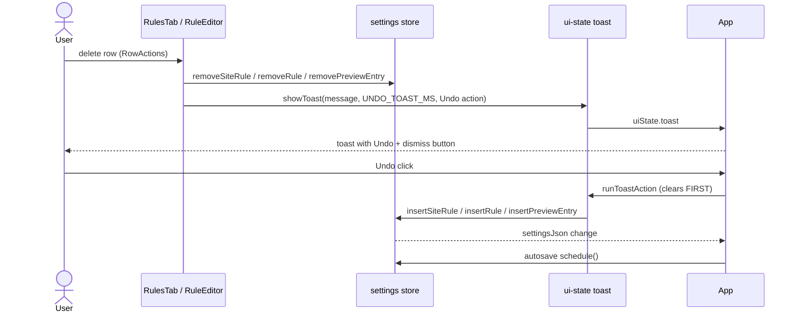
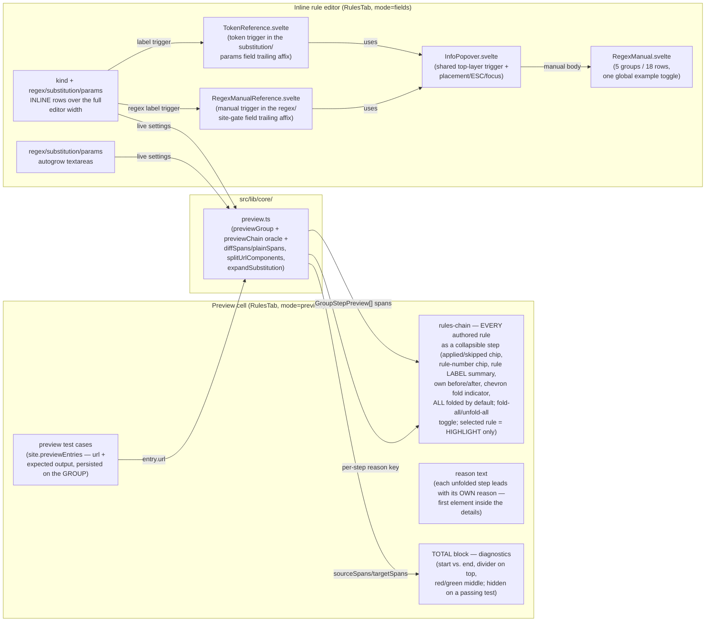

# Architecture: GUI

> How the Svelte 5 dashboard is structured: hash-takeover hosting, the responsive
> navigation (vertical rail on desktop, bottom bar on phones) with the header status
> segment, the restyled editor-column|preview
> layout with the inline rule editor, store binding, autosave flow, the rule
> editor's preview, the A9/R9 parity affordances (theme tri-state, assistant-tab
> hand-off, row-granular change count in the pending label, tokref, autogrow,
> filter), and the stats sink.
> Diagrams depict relationships, structure, and boundaries — no implementation
> details.

## Component Structure

```mermaid
flowchart TB
    subgraph Menu["Tampermonkey menu"]
        Entry["GM_registerMenuCommand<br/>(src/main.ts)"]
    end
    subgraph Gui["src/lib/gui/"]
        Dash["dashboard.ts<br/>(openDashboard + startDashboardMode:<br/>stop + DOM-wipe + ATTR-wipe + inject)"]
        App["App.svelte<br/>(chrome header + status segment +<br/>rail nav ↔ bottom bar + utilities<br/>+ tab body + toast)"]
        Rules["tabs/RulesTab.svelte<br/>(SINGLE-OPEN controlled explorer accordion + filter |<br/>group preview cell +<br/>INLINE rule editor folds + pointer/keyboard resizers +<br/>phone pane switch)"]
        Assistant["tabs/AssistantTab.svelte<br/>(split workbench: prompt card +<br/>JSON import + auto target · reveal link)<br/>+ components/ProviderLinks.svelte"]
        System["tabs/SystemTab.svelte"]
        StatsTab["tabs/StatsTab.svelte<br/>(insight layout + performance banner)"]
        TransferView["settings-transfer-view.ts<br/>(rows / tri-state / filter)"]
        Download["download.ts<br/>(GM_download + Blob fallback)"]
        Info["tabs/InfoTab.svelte"]
        I18n["i18n.svelte.ts<br/>(t, TRANSLATIONS)"]
        Valid["validation.ts<br/>(invalidRegexCount, pruneEmptyRows)"]
        AutoSave["autosave.svelte.ts<br/>(1/2/5 s debounce + pause gates +<br/>session snapshot + remote-sync policy)"]
        AutoSpeed["autosave-speed.ts<br/>(canonical steps + nearest/next mapping)"]
        UiState["ui-state.svelte.ts<br/>(uiState: popover, modal, toast)"]
        Clip["clipboard.ts<br/>(copyToClipboard)"]
        DragCtl["drag-controller.ts<br/>(pointer capture + ghost + autoscroll)"]
        IconReg["icon.ts<br/>(Material svg ?raw registry)"]
        CSS["dashboard.css (.rr-* + tokens)<br/>(?inline → adoptedStyleSheets)"]
            subgraph Components["components/"]
                Editor["RuleEditor.svelte<br/>(mode=fields / preview)"]
                Manual["RegexManual.svelte"]
                TI["TextInput.svelte<br/>(.rr-field wrap)"]
                TA["TextArea.svelte<br/>(.rr-field wrap + autogrow)"]
                CG["ChoiceGroup.svelte<br/>(segmented radio group)"]
                SCR["SettingsChoiceRow.svelte<br/>(settings label/hint row)"]
                Pop["InfoPopover.svelte<br/>(shared top-layer reference panel)"]
                RA["RowActions.svelte<br/>(clone/delete + optional<br/>group on/off toggle)"]
                Handle["DragHandle.svelte<br/>(row grip: pointer start + ↑/↓ reorder)"]
                Status["StatusLine.svelte<br/>(ready + shape + autosave phase;<br/>row count in the pending label)"]
                Indicator["AutosaveIndicator.svelte<br/>(header ring ↔ ✓ slot)"]
                Pill["AutosavePill.svelte<br/>(speed cycle only)"]
                Tok["TokenReference.svelte<br/>(field info trigger + anchored<br/>token popover)"]
                Grow["autogrow.ts<br/>(progressive textarea height)"]
                Hl["highlight.ts<br/>(tokenizeRegex + tokenizeSubstitution<br/>→ HighlightToken[], throw-free)"]
                Ico["Icon.svelte<br/>(aria-hidden glyph wrapper)"]
                Transfer["SettingsTransferDialog.svelte<br/>(native modal: export | merge | replace)"]
            end
    end
    subgraph AssetsBox["assets/icons/material/<br/>(README: source + Apache-2.0)"]
        Svgs["Material Symbols Outlined<br/>(checked-in SVGs, source fill #e3e3e3)"]
    end
    subgraph Stores["src/lib/stores/"]
        Store["settings.svelte.ts<br/>($state<Settings> singleton<br/>+ savedSettings derived from snapshot)"]
    end
    subgraph Core["src/lib/core/"]
        CoreSettings["settings.ts<br/>(saveSettings, normalizeSettings,<br/>theme normalization)"]
        Preview["preview.ts<br/>(previewGroup, previewChain)"]
        Stats["stats.ts<br/>(getStatsSink, ruleHash)"]
        Log["log.ts<br/>(setLogLevel)"]
        Parse["parse-regex.ts<br/>(isValidRegex, escapeUriForRegex,<br/>regexToReadableLiteral)"]
        ChatTpl["chat-template.ts<br/>(renderChatTemplate)"]
        AssistantCore["assistant-proposal.ts<br/>(parseAssistantProposal, resolveProposal)"]
        Diff["settings-diff.ts<br/>(countChanges)"]
        CoreTransfer["settings-transfer.ts<br/>(parse / diff / merge / replace / export)"]
    end

    Entry -.->|"GM_openInTab (hash-takeover)"| Dash
    Dash -->|"mount / unmount"| App
    Dash -->|"flush"| Stats
    Dash -->|"remote settings write (GM listener)"| AutoSave
    Dash -->|"inject CSS"| CSS
    App -->|"settings deep change → schedule()"| AutoSave
    App -->|"rail footer / header utilities"| Pill
    App -->|"header status"| Status
    Status -->|"autosave glyph"| Indicator
    Pill -->|"speed cycle"| AutoSpeed
    Indicator -->|"countdown state"| AutoSave
    App -->|"tab switch + reveal request"| Rules
    App -->|"tab switch"| Assistant
    App -->|"tab switch"| System
    App -->|"tab switch"| StatsTab
    App -->|"tab switch"| Info
    App -->|"save blocking"| Valid
    App -->|"counts + dirty"| Store
    App -->|"ESC: popover first"| UiState
    App -->|"toast render"| UiState
    App -->|"status count"| Diff
    App -->|"data-theme mirror + T hotkey"| Store
    AutoSave -->|"gate (invalid + empty-row scan)"| Valid
    AutoSave -->|"commit: store.save()"| Store
    Rules -->|"mode=fields → inline rule fold"| Editor
    Rules -->|"mode=preview → cell"| Editor
    Rules -->|"pointer/keyboard resizer (CSS var)"| CSS
    App -->|"status segment (header)"| Status
    Rules -->|"{TextInput, RowActions, DragHandle}"| Components
    Editor -->|"{DragHandle}"| Components
    Rules -->|"pointer drag controller"| DragCtl
    Editor -->|"pointer drag controller"| DragCtl
    Editor -->|"rule kind"| Tok
    Tok -.->|"open full reference"| Manual
    Assistant -->|"renderChatTemplate (optional target group)"| ChatTpl
    Assistant -->|"answer → proposal / resolve"| AssistantCore
    Assistant -->|"copyToClipboard + showToast"| Clip
    Assistant -->|"import: appendImportedRules / createSiteRuleWithRules"| Store
    Assistant -->|"reveal request"| App
    Editor -->|"preview model (both modes)"| Preview
    Editor -->|"{TextInput, TextArea, ChoiceGroup}"| Components
    Editor -->|"manual disclosure"| Manual
    TA -->|"use:autogrow"| Grow
    TI -->|"highlight=regex → tokens"| Hl
    TA -->|"highlight=regex / substitution → tokens"| Hl
    Hl -.->|"isNotationRegex (engine-truth detector)"| Parse
    System -->|"ChoiceGroup"| Components
    System -->|"open / apply / close"| Transfer
    Transfer -->|"row / selection mapping"| TransferView
    Transfer -->|"parse / diff / merge / replace / export"| CoreTransfer
    Transfer -->|"GM_download (Blob fallback)"| Download
    System -->|"modal flag"| UiState
    System -->|"snapshot + ruleHash"| Stats
    System -->|"live logLevel"| Log
    Rules -->|"live regex check"| Valid
    Rules -->|"gate escape toggle + readable captions"| Parse
    Rules -->|"bind:value"| Store
    Store -->|"save()"| CoreSettings
    App -->|"$derived t()"| I18n
    I18n -->|"reads locale"| Store
    App -->|"import"| CSS
    IconReg -.->|"?raw (inline into bundle)"| Svgs
    App -->|"tab + undo/close glyphs"| IconReg
    Rules -->|"grip-row glyphs"| IconReg
    RA -->|"action glyphs"| IconReg
    Manual -->|"info hover"| IconReg
    Ico -->|"name → svg string"| IconReg
    Rules -->|"glyph buttons"| Ico
    RA -->|"glyph buttons"| Ico
    Manual -->|"info glyph"| Ico
    App -->|"tab/undo/lock/close glyphs"| Ico
```



- State lives ONLY in the store singleton (`src/lib/stores/settings.svelte.ts`) —
  components bind directly into `$state` proxies; per-tab state is limited to the
  rules-tab OPEN GROUP + the selected rule, the explorer filter, the assistant
  target and import history, and the system-tab import-error
  flag. Transient view chrome (popover/toast) lives in `ui-state.svelte.ts` and is
  deliberately NOT persisted.
- Layout (restyle port, design A9/R43 + R9; revised 02.11., ADR 0022/0023;
  responsive navigation 11.11., [ADR 0045](../adr/0045-mobile-layout-bottom-nav-and-pane-switch.md)):
  one breakpoint source of truth — `(max-width: 760px)` in CSS and `matchMedia` in
  `App.svelte`.
    - 1101px and wider: RAIL (left, 92px) with the tab list and a rail footer
      (DEV/HMR chips, a 2×2 utility grid — theme + locale on top, the global
      skipped-step switch + autosave pill below — and the version), next to the tab
      content. The RULES tab renders a TWO-ZONE grid — editor column (left, DEFAULT
      50% of the width) | vertical grip | Preview cell (right, 50%, via
      `RuleEditor mode="preview"`).
    - 761–1100px: the same rail; the split STACKS explorer above preview with a
      HORIZONTAL grip between the panes. The preview cell gets its own panel
      surface, a strong top border and rounded top corners so the two stacked panes
      never blur into one scroll run; the ghost filter mirror is hidden (stacked it
      reads as a duplicated search field).
    - ≤760px: the rail becomes a BOTTOM BAR — 5 tabs, `--rr-bottom-tap` (44px,
      48px on coarse pointers), `env(safe-area-inset-bottom)` padding, brand-soft
      fill + top-edge marker for the active tab — and the utility cluster moves
      into the header actions (one `{#snippet}` instance, so `id="rr-locale-menu"`
      and the popover refs stay unique; the menu opens downward there). The header
      density steps down: title ≤560px, status label ≤400px, app icon ≤340px, tab
      labels ≤380px. The RULES tab drops the split for a segmented
      "Rules | Preview" switch in a STATIC bottom row directly above the bottom
      bar; both panes stay mounted in ONE grid cell and only `visibility` flips,
      so scroll position, open group, selected rule and inline-editor text
      survive. A chain-step click that arrives while the explorer is hidden
      selects the rule silently; only an explicit Rules tap scrolls the selected
      summary into view once.
- Shared in every mode: the RULES explorer hosts sites as `<details>` accordions —
  a SINGLE-OPEN accordion where every group starts FOLDED, only ONE may be open at
  a time, and unfolding binds the preview to that group; kind-chip + number rule
  rows with the INLINE rule editor inside the unfolded row, plus the filter input.
  With no group open, the preview cell shows an INERT mirror of the explorer filter
  row (same 32px control height, divider, and spacing) above the empty state, so
  both columns share the same top rhythm; the mirror contains no controls and only
  exists in the side-by-side split (ADR 0018).
  Since 27.10. (PADDING INVERSION, amended 02.11.) this needs NO negative-margin
  breakout: `.rr-dashboard` carries no horizontal padding; the header spans the
  window naturally, and the TAB PANEL carries the window inset (12px top, 20px
  left/right, 0 bottom — the work area reaches the window edge; phones use
  10px/12px). The two work columns only keep their grip/bottom breathing room.
  Rules and the centered tabs force classic 10px scrollbars (`::-webkit-scrollbar`;
  Firefox stays thin/classic), so the overlay thumb can never expand over the
  cards. Rules keeps 12px card-to-scrollbar clearance (8px on phones); the centered
  tabs reserve the same `--rr-scroll-lane` at the panel edge. Each column is its
  own vertical scroll container (`overflow-y: auto`, `overflow-x: hidden`); the
  grid itself never scrolls. Both grips resize a session CSS var (pointer events,
  double-click reset, arrow keys — 24px, Shift 64px): `--rr-explorer-w` (clamped
  420px … width − 340px) and `--rr-explorer-h` (clamped 200px … height − 200px; the
  grid clamps it again against the container so a shrunken window keeps the
  preview visible). Neither is persisted — deferred. Each grip is a focusable
  `role="separator"` with a measured `aria-valuenow` and a full-width
  `--rr-grip-w` hit rail (14px, 28px on coarse pointers) carrying a centered
  capsule: 3×40px `--rr-border-strong` at rest, 4×48px accent plus a blurred
  `--rr-accent-soft` halo on hover/focus, and 5×56px accent while dragging
  (class-driven `.active`); the horizontal grip swaps width/height. Its dimensions
  and halo opacity/scale use `--rr-motion-duration-fast` +
  `--rr-motion-ease-standard`; reduced motion switches states instantly. The add
  actions (add icon + label) use the ghost-accent family (`--rr-btn--add`, accent
  text + accent hover — R45). The status line renders ONCE in the chrome header
  between the brand and the actions — not a full-width bottom row, and the RulesTab
  grid has no status row. The status line is `aria-live="polite"`, so phase and
  shape changes are announced without moving focus. The header actions (refresh,
  undo, close) are three 28px neutral rail-pill circles; only close turns danger on
  hover (pills stay 28px on phones — 32px would overflow 360px next to seven
  buttons). Refresh asks for confirmation when the store is dirty (a refresh
  discards unsaved/paused work), then spins one turn via `.rr-btn--spinning`. The
  toast keeps `top: 68px + env(safe-area-inset-top)` so a notch never clips it.
- Touch contract (ADR 0032; scope tablet + touch notebook; phones 11.11.): the
  takeover boot re-installs the
  `width=device-width, initial-scale=1, viewport-fit=cover` viewport meta
  (`dashboard-meta.ts`) after the DOM wipe, so tablets do not use the ~980px
  fallback viewport and iOS reports real `env(safe-area-inset-*)` values for the
  bottom bar and the toast. Touch and pen share the ADR 0031 pointer controller;
  grips keep `touch-action: none` while the rest of the tappable chrome opts into
  `manipulation` (no double-tap delay, pinch zoom stays). Both list drags expose
  `destroy()`, which aborts an in-flight gesture, releases capture, and drops
  listeners when the owning tab or editor unmounts. `--rr-tap-min` (24px,
  32px on `any-pointer: coarse`) floors the grip/row-action/affix hit boxes,
  `--rr-grip-w` (14px, 28px coarse) sizes BOTH splitter rails (vertical width,
  horizontal height), `--rr-bottom-tap` (44px, 48px coarse) floors the phone
  bottom-bar tabs and the pane switch segments, and
  `--rr-field-fs` (0.95em, 16px coarse — the iOS focus-zoom threshold) is shared
  by fields, the highlight mirror and the leading affix; the site-gate and
  rule-editor fields use the scoped `--rr-editor-field-fs` (`--rr-fs-sm`, 16px
  coarse) for the Input/Output URL-panel surface (pane background, 8px padding,
  1.6 line-height, no inset shadow) on the field, its highlight mirror and its
  leading affix; the rail itself reads as a static prefix (panel-2 surface,
  strong divider, muted bold glyph), never as a button or editable text. The
  inline `.rr-summary-desc` overlays keep `font: inherit`
  and grow 6px/8px outward with mirrored offsets; a dotted hover underline on the
  caption advertises the edit route. The group description is edited through the
  `InlineCaption` overlay (double-click, F2 on the focused summary, or the trailing
  pencil); the group
  body itself opens with the site-gate `TextInput`. The shell uses `100dvh` after a `100%` fallback, and `.rr-pop`
  caps at `min(80dvh, 720px)` with internal scrolling.
- Icons (27.10.; consolidated 02.11.; extended 03.11.): Material Symbols
  Outlined SVGs are checked into `assets/icons/material/` (README: source fonts.google.com/icons,
  Apache-2.0) plus a small set of inline paths in `src/lib/gui/icon.ts`
  (`visibility`/`visibilityOff`/`search`/GitHub/
  download/upload). `?raw` imports INLINE everything in the userscript bundle —
  no runtime URL fetch, no Google-Fonts link (removed 02.11.). `Icon.svelte`
  renders the registry (`aria-hidden` wrapper; accessible names stay on the
  buttons; Close and the rail pills are icon-only with `aria-label`). The SVG files carry
  `#e3e3e3` as their source fill, but `.rr-icon svg { fill: currentColor }`
  makes glyphs follow the text color in BOTH themes; scoped accent/danger/faint
  rules override it. The chat-template ⧉ text button stays (user decision).
- Rule fold (02.11., ADR 0022; replaces the editor dock): every rule row is a
  native `<details>`; unfolding it mounts the `mode="fields"` RuleEditor INLINE
  inside `.rr-master-rules` (conditional mount — a fields-only instance never
  computes the preview chain). Selection == open: exactly one rule is unfolded
  at a time (single-open across groups), unfolding selects it, closing clears
  the selection; opening a GROUP does not select a rule. A chain-step click
  selects the rule, unfolds it and scrolls it into view (no focus steal); on the
  phone pane switch it selects silently and the explicit Rules tap scrolls it
  into view once. New rules (add + assistant import link) open automatically.
  The row summary carries the
  chips, label and RowActions. All row chrome (actions and the caption pencil)
  stays hidden at rest on hover-capable devices; hidden chrome collapses so the
  label/caption owns the width, and it expands on row hover, keyboard focus, or
  open/active state — an open site group counts as active (`hover: none` keeps them
  visible and reserved; ADR 0031). Site rows carry the group on/off toggle in the
  same strip (ADR 0038): `toggle_on`/`toggle_off` with `aria-pressed`, hidden at
  rest on hover-capable devices like clone/delete. The off state is also visible
  at rest through a muted row (caption, chevron, grip), and the preview cell
  shows a disabled banner. Rule and test-case rows never get the toggle.
  The open GROUP gets a brand border only (`.rr-master > details.rr-master-site[open]`,
  no glow); the open rule gets the preview-parity highlight — brand border +
  `--rr-brand-soft` fill, matching the selected chain step. Paused, drop-target
  and drag-ghost groups keep their own frames instead of the brand border.
  Reordering is pointer drag-and-drop only and starts from the row summary
  (ADR 0021). The token reference trigger sits in the substitution/params field
  trailing affix (field-anchored popover); the LLM hand-off is its own rail tab
  (ADR 0035). The preview `RuleEditor` is keyed by the open site, so fold/filter
  state never bleeds between groups; chain-step folds are keyed by stable rule
  identity (a WeakMap), so a reorder keeps its fold. Structural mutations
  (reorder, clone, delete, undo) re-persist `lastSelection` through
  `rememberSelection`, which drops a pair that no longer resolves.
- Site gate captions + escape toggle (27.10., description edit 02.11.): the site
  caption (explorer summary) prefers the optional `SiteRule.description`; when it
  is absent or empty it falls back to the gate in its READABLE raw form
  (`regexToReadableLiteral` — notation + backslash escapes stripped, "the URI
  as one knows it"). The explorer filter matches BOTH the visible caption and
  that readable form, so a described group stays searchable by its regex.
  Double-clicking the caption (or pressing F2 on the focused summary) overlays
  it with a compact text field at IDENTICAL font metrics; the field box is
  expanded 6px/8px OUTWARD with compensating padding, so the glyph origin and
  the row height stay fixed (the ring sits in that expansion — no layout shift),
  and the placeholder overrides the UA alpha with solid `--rr-muted` at full
  opacity: Enter/blur commits a trimmed
  description, Escape discards it, and an empty value removes the field
  (fallback again). A single click still toggles the group; the double-click is
  the component's OWN click pair (`CAPTION_EDIT_CLICK_MS`, 800 ms) gated to
  mouse/pen `pointerdown`, not the native `dblclick` (whose OS interval is too
  tight). The second click calls `preventDefault` and restores the fold state the
  first click captured, so editing neither toggles the row twice nor leaves it
  open; `e.detail >= 2` stays as the fallback for long OS intervals. A pencil at the
  caption's trailing edge (ADR 0031) is the touch route: one tap opens the same
  overlay, and the glyph stays hidden until row hover, focus, or open state; the
  title host collapses its 28/36px reserve at rest (URL-value pencils keep a fixed
  reserve). The group body no longer carries a description field. The Hack webfont
  is declared in `dashboard.css` with `font-display: optional`, so a late font
  arrival cannot reflow the row after the field opens. The gate
  FIELD integrates both affordances INSIDE its visual box (TextInput
  `leading`/`trailing` affix snippets — absolute overlays, the input reserves
  padding via `has-lead`/`has-trail`): LEADING the muted monospace `.*` regex
  indicator (decorative, aria-hidden), TRAILING the ICON-ONLY escape toggle
  (`Icon autoFixHigh`, direction via `aria-label`/`title`) followed by the regex
  manual trigger: plain text → `/…/`-escaped notation (`escapeUriForRegex` —
  MUST carry the slashes, or the literal fallback would double-escape the
  backslashes), notation → unescaped plain text. TOGGLE was an explicit user
  decision — unescaping is LOSSY for real regex constructs (`\d` → `d`, flags
  dropped), pinned by parse-regex tests. The EDITOR's regex fields (replace
  regex + appendQuery gate, inline-editor TextAreas) carry the same `.*`
  indicator plus the manual trigger in their field trailing affix — no escape
  toggle there (multiline first-line marker variant, `rr-field-control-multi`);
  the substitution/params fields deliberately get no `.*` (they are not regex)
  but carry the token trigger in their trailing affix.
- Explorer summary header (02.11. restyle): the readable site caption
  (`description` when set, else the readable gate) is the row anchor
  (`--rr-fs-md`, `--rr-text`, ellipsis), and a danger `dataInfoAlert` marker with
  the `rules.groupInvalidRegex` tooltip flags a group whose gate OR any rule
  regex fails to compile (`siteHasInvalidRegex`) while folded. The trailing
  action strip carries the 6px caption-field clearance (the edit overlay
  overhangs 6px, keeping 8px field-to-strip); hidden it collapses so the caption
  owns the width, and it re-expands on hover, focus or open group. The header row
  carries a hover background (`--rr-panel-2`) and a
  `:focus-visible` accent ring; both are scoped to `.rr-master >` because preview
  test-case rows share `rr-master-site`/`rr-group-summary`. Preview rows get the
  same band, ring and collapsing hover-revealed actions through `.rr-preview-zone
details.rr-ed-preview` (ADR 0030) — the `details` element is required because
  `rr-ed-preview` also names the outer preview section. The amber
  `.rr-autosave-paused` frame now marks INCOMPLETE groups only (empty gate/row,
  `isSiteIncomplete`); invalid regexes are the red marker, and a mixed group
  shows both. Autosave still pauses via `isSitePersistBlocked`; the status line
  and `rules.blockingHint` remain the global persistence signal.
- Group test indicator (11.11.): `summarizeGroupTests` (`preview.ts`) derives
  pass/fail counts from the group's real test entries (non-empty
  `testOutputUri`; preview-only entries are ignored). ONE aggregated dot sits
  BEFORE the title — never one dot per test: green = all pass, amber = mixed,
  red = all fail, faint = no real tests. Disabled groups stay testable and keep
  their verdict.
- Inline editor fields (R8/R9/R11/R12; reworked 02.11., ADR 0022): ONE column —
  inline field ROWS (`.rr-ed-row`, fixed label column) for kind, regex and
  substitution/params (label LEFT of the field, no stacking; phones keep the
  same row with left-leading label text). Both reference
  popovers share `InfoPopover.svelte`: the trigger sits in the field trailing
  affix and the popover is a native non-modal `popover="auto"` dialog in the TOP
  LAYER, so the tab panel's `contain`/`transform` and the explorer scroll cannot
  clip it; it sits at the preview column's left edge in the two-column layout
  and below (or above) the trigger when stacked. The popover header uses the
  About details card-head band (16px accent icon + uppercase muted title); token
  references keep their lead as an intro strip above the body (the manual has
  none), never in the title bar. The
  WHOLE header is the drag surface (mouse/touch/pen; the close button keeps its
  own click) and the grip is a visual affordance. A bottom-right stretch grip
  resizes width and height within a per-variant floor (manual 640px, tokens
  420px) and the viewport; the body owns the scroll, so header and grip stay
  put. Dragged position and stretched size stick for that open session and
  reset on close. The KIND-DEPENDENT token reference sits
  in the substitution/params
  trailing affix (04.11.): "replace" opens the substitution tokens,
  "appendQuery" the params tokens (`k=v`, `&`, skipped `k`-segments,
  fragment-safe insertion, verbatim values — append-query.ts semantics) with a
  matching title (`tokref.titleParams` / `tokref.title`). The regex field
  trailing affix carries the manual trigger (`RegexManualReference.svelte`) for
  every rule kind — a checkpoint has no token trigger but keeps the manual.
  The site-gate field uses the same manual under a per-group
  `siteManual:<index>` key so only the clicked gate opens (all folded groups
  keep their triggers in the DOM) and it can never open together with the rule's
  manual. There is no manual disclosure and no second access path.
  The kind `ChoiceGroup` shows short segment labels and carries the full difference as
  `title` (`Replace (regex search & replace)` / `Append query (add URL parameters)` /
  `Checkpoint (regex condition, stops or continues the chain)`).
  A checkpoint shows its regex field plus a `continue`/`stop` selector.
  Regex/substitution/params as MULTILINE `TextArea`s with progressive autogrow
  (`autogrow.ts`, no cap; the `.rr-master` explorer column owns the scrollbar). The
  visible row labels sit outside the controls in the grid, so each `TextArea` is wired
  to its label with `aria-labelledby` (the `ariaLabelledby` prop).
  The fields section is chromeless inside the rule body. The preview URL row's
  load-sample button was REMOVED (27.10.) — `SAMPLE_URL` stays in `preview.ts`
  (unit tests use it). The site gate editor moved from the accordion `<summary>`
  into the opened group body (02.11.); the summary carries the readable caption,
  the invalid-regex marker, and the RowActions strip.
- Regex/substitution highlighting (27.10.): `src/lib/gui/highlight.ts`
  tokenizes field values into `HighlightToken[]` — `tokenizeRegex` splits the
  `/pattern/flags` NOTATION (same `isNotationRegex` detector as the compile:
  non-notation strings stay WHOLE plain, engine-truth) into delim/flag/esc/
  class/group/quant/alt/anchor/plain tokens (throw-free, best effort on broken
  input), `tokenizeSubstitution` follows ECMA-262 GetSubstitution (`$$`, `$&`,
  `` $` ``, `$'`, `$1…$99` two-digit preferred, `$<name>`). Rendering is a
  MIRROR layer (`.rr-mirror`, `highlight?: "regex" | "substitution"` prop on
  TextInput and TextArea): the colored spans sit absolutely positioned BEHIND
  the transparent field text (`pointer-events: none`; the field text turns
  transparent via `.rr-hl` with `caret-color`), metrics-pinned by copying
  border + padding + font + wrap exactly (`.rh-*` classes color-only — NO
  font-weight, weight differences would shift glyphs). The round-trip
  join(tokens) === input is pinned by `src/lib/gui/__tests__/highlight.test.ts`.
  Wired: site gate TextInput (`regex`), editor regex/gate TextArea (`regex`),
  editor substitution TextArea (`substitution`); single-line mirrors follow the
  input's horizontal scroll via scrollLeft sync (autogrow textareas never
  scroll internally — no sync needed).
- Assistant tab (ADR 0035; split workbench since 04.11.): the tab sits directly
  after Rules in a 960 px centered root. The compact hero carries only the
  headline and lead, with `ProviderLinks.svelte` as a right-hand panel of nine
  static external links (ChatGPT, Claude, Copilot, Gemini, Mistral, Kimi,
  DeepSeek, Qwen, Perplexity); brand glyphs come from the separate
  `assets/icons/brands/` family (Simple Icons, monochrome via `currentColor`,
  12 px). There is no stepper, no step state, no benefit chips and no hero glyph.
  Below it, `.rr-asst-workbench` is a two-column grid
  (`minmax(0, .92fr) minmax(0, 1.08fr)`, 12 px gap, `align-items: start`) that
  stacks at ≤1080 px.
  The prompt card always shows the OPTIONAL target site group select (styled
  field with globe + chevron, plural rule-count meta), a derived summary (gate /
  rule count / `JSON`), and a collapsed `<details>` prompt preview that renders
  exactly the `renderChatTemplate(site | undefined, locale)` string the copy
  action uses. "Automatic" omits the group dump and the template asks the LLM for
  the target site. There is no starting-rule select and no page-url control. The
  full-width copy button is the primary CTA; a hidden `.rr-visually-hidden`
  textarea backs the `execCommand` fallback and a `<pre>` appears when the
  clipboard is blocked.
  The import card accepts the proposal JSON (single rule or group, Markdown
  fences tolerated) in a compact field with an inline paste button (clipboard
  read; fallback focuses the field and toasts Ctrl+V), shows the resolved target
  (existing gate vs. a new group), the new and duplicate rule counts, and an
  optional site-gate input when the answer has none. In the split card the
  status line stacks above the wrapping button row. Import appends through
  `store.appendImportedRules` or creates a group via
  `store.createSiteRuleWithRules` (append-only: LLM rules have no stable index),
  then replaces the paste field with a success panel. A proposal may also carry
  group-level `previewEntries` verification cases (one per used rule kind); they
  are deduped against the target and appended with the imported rules, or seed a
  new group. Imported rules stay in a
  session-local list below it (object refs resolve indexes at click time); "Open
  in Rules" emits a consume-once reveal request that App turns into a tab switch
  plus `RulesTab` selection. The tab only reads `settings.lastSelection` as the
  default target. Copy goes `GM_setClipboard` → `navigator.clipboard` →
  `execCommand` (`clipboard.ts`); the toast receipt is shared view state
  (`ui-state.svelte.ts`, 3.2 s plain / 8 s undo, ADR 0039).
- Hosting (ADR 0011 + ADR 0012): the dashboard tab opens on the inert host stub +
  `#rr-dashboard` (`DASHBOARD_HOST_URL`/`dashboardUrl`; experimental `about:blank`
  via the persisted `dashboardHost` setting), taken over by `startDashboardMode`
  at document-start...
  ATTRIBUTE wipe (class/style on `<html>`/`<body>` — site theme bleed) + fullscreen
  mount) — the app runs in its OWN context, GM storage accessible directly.
  On the Vite dev port (`:5173`, no `import.meta.hot`), a bundled userscript
  defers to the Vite app; `startDashboardMode` also guards against a second
  mount in the same window (duplicate ids/top-layer state).
  The boot then re-installs the device-width viewport meta (`dashboard-meta.ts`,
  ADR 0032) before layout runs.
  All window wiring (ESC, beforeunload) targets that window via the `win` prop —
  `svelte:window` also points there (same realm), the prop keeps the wiring explicit.
  The ESC handler ignores events a child already handled (`defaultPrevented`),
  editable targets, and an active drag (`document.body.rr-dragging`), so a field edit,
  a drag, or a consumed key never closes the dashboard. Unmount tears down the refresh
  timer and the tab-activation `requestAnimationFrame`; `RulesTab`/`RuleEditor` call
  `destroy()` on their drag controllers.
  The dev/E2E dashboard-host override is honored only in dev builds or under the
  Playwright handler; real managers use the persisted `dashboardHost` setting.
- Cross-tab protocol (`dashboard-protocol.ts`, MULTI-DASHBOARD decision 27.10.):
  the `#rr-dashboard` url marker + the BOOT request value ("Create new Rule"
  prefill for the tab the menu click OPENED — id-tracked). The active dashboard
  tab is also encoded as a path segment after the marker (`#rr-dashboard/stats`);
  App.svelte updates it on tab switch via `history.replaceState`, and
  startDashboardMode reads it back as `initialTab` on reload. NO heartbeat, NO
  forwarding: every menu click opens its own dashboard tab. Dashboard↔dashboard
  sync runs over the settings key instead (`GM_addValueChangeListener` →
  `autosave.svelte.ts` `onRemoteSettingsChange`: remote reload while clean,
  conflict hint while dirty — document-level last-write-wins, no merge).
- `t()` in `i18n.svelte.ts` reads the store locale — reactive inside templates,
  so a locale switch relabels the open dashboard instantly. `t(key, params)`
  interpolates `{name}` placeholders. The chat-template BODY is the one
  deliberate exception: `src/lib/core/chat-template.ts` owns its de/en document text
  (a generated artifact, unit-testable without the store — same purity
  rationale as preview.ts). Both bodies carry `{{include:chat-contract.<locale>}}`;
  `scripts/build-defines.ts` expands it to
  `src/lib/data/chat-contract.<locale>.txt` before Base64 encoding, so the rule model
  and the test-case contract exist once per locale and cannot drift.
- Theming (ADR 0013): TRI-STATE `auto|dark|light` — `data-theme` on the takeover
  `<html>`; `auto` follows `prefers-color-scheme` scoped to
  `[data-theme="auto"]`, `dark`/`light` force the token sets. The manual toggle
  (rail pill + `T` hotkey, guarded against editable targets) PERSISTS via the
  autosave flow (configured debounce, like locale). The locale pill opens a
  small Auto/English/Deutsch popup (Auto stays selectable); `t()` relabels
  instantly. Brand = the app-icon fill `#3b82f6` in ALL themes (`--rr-brand` /
  `--rr-brand-soft`, ADR 0027) for brand surfaces and glyphs — the active rail
  tab (glyph, frame, marker, active band) is brand while its label keeps the
  AA-raised accent. Accent (text + functional graphics) = C7 Kobalt (`#3561e8`
  auto-light vs `#1d4ed8` forced-light — prototype R29 nuance); buttons =
  B2+Border (bordered ghost, danger close, changes count in the status line).
- Contrast fixes: the auto-light token set darkens `--rr-faint`, `--rr-ok`, and
  `--rr-u-ctx`; paused/conflict status text uses `--rr-status-warn` because the raw
  warn tone fails contrast on the light chrome; `.rr-chip-site` uses the neutral
  `--rr-muted`/`--rr-panel-2` tokens instead of white-on-dark overlays.

## Autosave + Close Flow (decision 27.10.)

```mermaid
sequenceDiagram
    participant U as user
    participant A as App.svelte
    participant P as AutosavePill.svelte
    participant I as AutosaveIndicator.svelte
    participant X as autosave.svelte.ts
    participant V as validation.ts
    participant S as settings.svelte.ts
    participant C as settings.ts

    U->>P: click stopwatch (fast → normal → slow)
    P->>A: settings.autosaveDelayMs = next canonical delay
    U->>A: any settings change
    A->>X: untracked schedule() — the $effect re-arms the configured debounce
    X-->>I: pendingSeq + pendingDelayMs (header ring fills clockwise)
    X->>V: gate check when the timer fires<br/>(invalidRegexCount + empty-row scan)
    alt gate blocks (invalid regex / empty row)
        X-->>U: phase "paused" (full amber ring + status hint,<br/>NOTHING persists, editor state survives)
    else ok
        X->>S: store.save()
        S->>V: pruneEmptyRows(settings)
        S->>C: saveSettings(settings) → boolean
        alt GM write failed
            S-->>X: false — savedSnapshot NOT advanced
            X-->>U: phase "paused" (write hint, state stays dirty)
        else write ok
            S->>S: savedSnapshot = JSON.stringify(settings)
            X-->>U: status "saved at HH:MM" (header checkmark slot)
        end
    end
    U->>A: Undo (session snapshot)
    A->>X: restoreSnapshot() — store.replace(boot state) + commit
    U->>A: Close / ESC / tab close
    A->>X: flush() — synchronous GM write (what the gate allows)
    alt paused AND dirty
        A-->>U: confirm "Unsaved changes!" (beforeunload = native prompt)
    end
    A->>A: onClose → unmount + window.close (dashboard.ts;<br/>refusal → close-it-manually hint)
```

- AUTOSAVE policy (decision 27.10., ADR 0024): pure configured debounce (no
  maxWait — deliberate). The rail stopwatch cycles the canonical delays
  1 s / 2 s / 5 s; the HEADER `AutosaveIndicator` shares one slot between the
  countdown ring and the ✓, and `pendingSeq` restarts the CSS animation. The gate PAUSES
  persisting while a non-empty regex fails to compile OR any rule/site group is
  entirely empty — `pruneEmptyRows` would delete a freshly prefilled "Create new
  Rule" row; empty site/replace regexes are rejected by the engine
  (`validation.ts`). A rejected GM write is a third pause reason (`write`):
  `saveSettings` returns false, `savedSnapshot` does NOT advance, and the next
  change or the close `flush()` retries.
- EFFECT contract: the App autosave effect tracks ONLY the dirty comparison
  (`settingsJson !== savedSnapshot`) and calls `schedule()` untracked.
  `schedule()` reads and writes `autosave.*`; its arm counter is a module-local
  variable (`pendingSeqCounter`) instead of `autosave.pendingSeq += 1` — a
  tracked read-modify-write would re-invalidate the caller forever and Svelte
  aborts with `effect_update_depth_exceeded`.
- CLOSE save policy (ADR 0024): there is no save button. Close/ESC/tab close call
  `flush()` — a SYNCHRONOUS GM write using the SAME gate; incomplete rows pause
  instead of being pruned, and a paused-dirty state still raises the confirm.
- Import replaces via `store.replace()` — normalized fail-soft BEFORE assignment,
  so the store can never hold an invalid shape. The removed raw-JSON editor is
  superseded by the file-based export/import (plan D7).
- Changes count (R13, decision 27.10., ADR 0024 — ROW granularity): every
  added/removed/modified site or rule counts 1 (`countChanges` in
  `src/lib/core/settings-diff.ts`, ordered compare — a moved row counts as
  changed, no row identity). The store keeps a parsed `savedSettings` mirror
  next to the snapshot string; the count is merged into the pending label
  (`saving N changes…` / singular `saving 1 change…`; a settings-only change
  with no row diff falls back to `saving changes…`). The applied state renders
  `✓ saved HH:MM`, paused keeps its own text (no count). The old save-button
  badge and the separate `Changes: N` status span are gone.
- UNDO (decision 27.10.): session snapshot — the PERSISTED state at dashboard
  boot (`autosave.svelte.ts` module init). The undo button restores it (confirm
  whenever the session differs from it — NOT `!dirty`: after an autosave commit
  the store is clean but the session still differs, and the undo IS the safety
  net for automatic saves). Tab-local by design; restoring also persists so the
  other dashboards adopt via remote reload. This is NOT the row undo below.

## Delete + undo toast (ADR 0039)



- Row deletes never call `confirm()`: the site group, rule, and test-case paths
  remove immediately and open a single-slot toast, fixed top-center below the
  56px chrome header. The toast uses the hero-glow recipe (brand border, soft
  radial tint) plus a countdown ring that grows over the toast duration, tied to
  the JS timer, so it reads as a distinct notification surface rather than
  another neutral panel (`ui-state.svelte.ts`, `UNDO_TOAST_MS` = 8 s). A plain
  receipt keeps the 3.2 s timing.
- The undo action renders a Material `undo` glyph before its label; the icon is
  `aria-hidden`, so the accessible name stays the plain `common.undo` label.
- Every toast also renders an icon-only dismiss button at the far right
  (`toast.dismiss`, Material `close`). It only calls `dismissToast()` — the
  delete is NOT undone, and the countdown/pause state is cancelled with the
  toast.
- The toast action clears the toast before running, so the action may replace it
  with a failure message (`common.delete.undoFailed`) when the parent group is
  gone.
- Restore inserts the captured plain settings object at the original index,
  clamped to the current list length (`insertSiteRule`, `insertRule`,
  `insertPreviewEntry` in `settings.svelte.ts`). A rule undo re-opens the group
  and re-selects the rule; a site undo re-opens it only when it was open before.
- Single slot, no stack: a second delete or any other toast replaces the pending
  undo. Hover and focus hold the timer; leaving resumes with the remaining
  duration (ring and timer stay in sync).
- Native `confirm` remains only for close-on-paused-dirty, session undo, refresh-while-dirty,
  and the DEV menu reset (`main.ts`), which are outside the row-delete flow.

## Editor pane — preview + manual + tokref (plan D9–D14, R8–R51; group binding 27.10.)



- The MODE SPLIT renders two RuleEditor instances (fields in the unfolded rule
  row, preview in the cell) against the SAME pure derivations — both are cheap
  ($derived over settings). A fields-only instance is mounted only while its
  rule is open and skips the preview derivation entirely. The preview needs only
  the GROUP (ruleIndex -1 = no rule selected: steps render, reason hides); the
  fields need the RULE.
- `previewGroup` replays the EXACT `applyRules` semantics SCOPE-BOUND TO THE
  ONE GROUP (the gate evaluates once against the entry url, rules apply
  sequentially, span-tracked) — engine parity is pinned by `preview.test.ts`
  against `applyRules` outputs (single-site `compileRules`). `previewChain`
  stays as the FULL-settings parity oracle.
- The chain's site-gate step reads its MATCH badge from the shared executor
  result (`GroupPreview.gateMatched`) — one compile, one evaluation, no second
  gate parse. An EMPTY gate keeps the documented match-all authoring display
  even though `compileRules` drops the group (so `gateMatched` is false there).
- The chain renders EVERY authored rule (27.10.): rules that do NOT change the
  url still appear as a SKIPPED step (no-match / gate-no-match / unchanged /
  invalid-regex). The SELECTED rule is only HIGHLIGHTED — steps NEVER
  auto-unfold; folding is manual, default ALL folded, and every UNFOLDED step
  leads with its own reason text (first element inside the details, above the
  before/after panels). Chip numbering = the rule number WITHIN the group
  (explorer parity); the summary shows the RULE LABEL (regex/params) instead of
  url changes. Folding is CONTROLLED (`bind:open` per step): a LEFT-aligned
  chain toolbar hosts ONE fold-all/unfold-all toggle (`Icon unfoldMore` when
  everything is folded, `unfoldLess` when anything is open — 27.10.) followed
  by the CHAIN STAT — rule count + the TIMED group-replay duration
  (`preview.chainStat.one`/`preview.chainStat.other` + `preview.chainStat.time`; sub-1ms
  replays render qualitatively via `preview.msFast` — "took less than 1 ms";
  Intl locale-formatted ms; the `$derived.by` derivation wraps `previewGroup`
  in `performance.now()`), and each
  summary leads with a `chevronRight` fold indicator (CSS-rotated like the
  explorer accordion).
- Skipped-step visibility (04.11., ADR 0040): the chain toolbar's local eye
  button and the rail footer's global switch share one precedence —
  `effective = local exception ?? settings.hideSkipped`. The local exception is
  session-only, keyed by GROUP identity (reorder/clone safe), persists across
  group switches, and is dropped when a local click lands on the global value.
  Flipping the global switch clears every exception; it persists via autosave
  and is excluded from backup export/import. An active exception outlines the
  local button in the brand color and appends `preview.localOverride` to its
  accessible name. Checkpoint steps stay visible in both states.
- Preview-cell rhythm (27.10.): the dashed divider separates the TOTAL block and the
  URL row from the chain toolbar.
- Below the chain, the TOTAL block (start vs. FINAL url) diffs common
  prefix/suffix between the start and the final url — the diverging middle is
  red on the start side, green on the end side. It is separated by a
  horizontal divider (no accent border anymore — 27.10. user decision) and
  uses the full horizontal width. It stays visible only while the pinned test
  is missing or failing; a passing pinned test hides it because the summary
  rows already show the identical start/end pair.
- Input/Output rows are STACKED, not side by side (03.11.): `.rr-preview-grid`
  is one shared 2-column grid (`max-content` label column + `minmax(0, 1fr)` panel),
  so the `Input`/`Output` labels sit OUTSIDE the panels, column-aligned and
  baseline-aligned to the first URL line (same label-left pattern as the
  summary URL rows). The TOTAL block and the expanded step bodies share it.
- Test cases live ON THE SITE GROUP as `SiteRule.previewEntries` (02.11.,
  superseding the single `site.testUrl`): each entry has `url`, `testOutputUri`
  (empty = preview only), and `description`. The preview cell lists one
  collapsible row per entry. The row summary (03.11. trim, inline URL rows) is
  description-first:
  `InlineCaption` shows the trimmed `description`, else `"—"`; double-click,
  F2, or the trailing caption pencil (ADR 0031) opens
  the shared absolute overlay field (Enter commits, Escape cancels, blur commits,
  an unchanged trimmed value is skipped). A short icon-less status chip
  (`ok` / `fail` / `—`) sits between the chevron and the caption; its long label
  (`preview.test.successful/failed/noTest`) is the tooltip and the visually
  hidden accessible name, while color carries the state. Hover-revealed
  `RowActions` (ADR 0021 behavior) trail the row. Under the caption an
  inline-editable URL block (`previewSummaryUrls`) always shows `Input` and
  `Output` as label-left rows (one shared `max-content` label column, 6px gap)
  and spans the full
  summary width (all three grid columns), separated from the caption line by a
  dashed rule. Each value is a `.rr-preview-panel` with the same URI tones and
  red/green diff as the TOTAL block (`PreviewSpans`); the diff compares the two
  displayed values (trimmed input → trimmed expected output) and is independent
  of the test result — the status chip alone reports pass/fail. Empty values show
  `—` without a diff. A double-click (the same 800 ms click pair, mouse/pen) or
  the row pencil opens the same zero-jump overlay; long URLs clamp to two lines
  with the full value as tooltip. The
  expanded body carries only the chain and, for a missing/failing test, the
  TOTAL block — no URL or description fields; the summary is the only editing
  surface for both. The caption is description-only because the input URL has
  its own row.
  Each entry replays the WHOLE chain of the group. The preview filter
  matches the description too and shows `preview.filter.empty` when entries
  exist but none match. The add-preview skeleton renders below both the empty
  and the populated list (a group without entries must be able to create its
  first one). The Create-new-Rule menu request prefills one entry from the
  opener url. Legacy site-level `previewUrls` and single-URL preview entries
  (`testUrl`) migrate on normalize; a legacy RULE-level `testUrl` is dropped.
  The normalize contract is UNIFORM STRINGS: `testOutputUri`/`description` AND the
  appendQuery/removeQuery gate regex are ALWAYS `""`-strings after normalize (Svelte-5
  `$bindable` bindings THROW on undefined props — pinned by settings tests).
- URI components (scheme/userinfo/host/port/path/query/fragment) get muted backgrounds
  that always defer to the red/green diff overlay (D14). Text wraps per-CHARACTER
  (`break-all/anywhere` — URLs have no word boundaries).
- Rule-kind memory (04.11., session-only): switching kind keeps the shared
  `regex` and restores the target kind's distinct field (`substitution` /
  `params` / `mode`) from a per-rule draft — a first-time kind starts
  empty/default. Drafts are keyed by the LIVE rule object (WeakMap, ADR 0040
  pattern): reorder/selection safe, absent on clones, gone on reload or a tree
  replacement (`store.replace` / `reloadRemote`). Only the ACTIVE kind is
  persisted; drafts never enter settings, autosave, or backups.
- The token reference (R8; field trailing affix since 04.11.,
  `TokenReference.svelte`) renders only for `replace` and `appendQuery`. It
  shares `InfoPopover.svelte` with the manual: the trigger sits in the field
  trailing affix and the popover is a non-modal native `popover="auto"` dialog
  in the top layer, positioned at the preview column's left edge (two-column)
  or below/above the trigger (stacked). The trigger is SHOW-only
  (`popovertargetaction="show"`), so a second click keeps the panel open; close
  via the header button, ESC, or light dismiss. Placement happens BEFORE the
  panel is shown: the click cancels the native invoker, `position()` measures a
  temporarily hidden closed box, then `showPopover()` runs — the first frame is
  never painted at the UA static position. The body mounts lazily on first open
  (`tick()` before placement), so folded groups keep only the trigger, not a full
  manual table. Entry/exit fades and lifts via
  `@starting-style` + `allow-discrete` (`display`/`overlay`), off under reduced
  motion. The header band follows the
  About details card-head (accent icon + uppercase title) and drags the panel by
  mouse/touch from anywhere except its buttons; the lead sits as an intro strip
  between header and body. A direct switch between two reference popovers keeps
  the newcomer open (the old close never clears the newcomer's slot; the hide
  effect defers one frame). The body is a vertical token list (code chip left,
  meaning right), no chip wall. `uiState.popover` remains the single
  slot shared with the rail locale menu (`"tokens" | "manual" | "locale" |
siteManual:<index> | null`), so only one is open at a time and ESC closes it
  locally before App's dashboard close flow. The per-group site key matters:
  every folded group renders its gate trigger, so a shared key would open all of
  them and each `showPopover()` would auto-close the previous one.
- `RegexManualReference.svelte` puts the manual trigger in the regex field
  trailing affix for every rule kind (a checkpoint has no token trigger) and in
  the site gate's trailing affix under the per-group `siteManual:<index>` key.
  The manual popover renders `RegexManual` only — no compact strip, no
  disclosure, no token-popover link.
- `RegexManual.svelte` groups the table into 5 sections (notation, patterns,
  substitution, appendQuery params, gates & checkpoints) with 18 token rows and
  exactly one example per row. ONE global "Examples" toggle in the Meaning table
  head (no extra column) reveals every example (default hidden); the token rows
  stay visible. It documents the
  whitespace-variant support (plan W4: authored `" "`/`\s` match `%20`;
  character-class limitation).

## Settings transfer dialog (ADR 0037)

- `SystemTab` owns the trigger and the apply/close hand-off. It opens the native
  `<dialog>` for export or import, passes `store.settings` as the live left-hand
  side, and on apply calls `store.replace(next)` followed by the existing autosave
  `flush()` gate (no second save path, no pruning).
- `SettingsTransferDialog.svelte` renders one current-value column for export and
  current/imported columns for import. Import defaults to merge; replace is
  enabled only for a complete, fully valid file. The "only differences" filter
  hides identical imported units but keeps invalid units, current-only "stays"
  rows, and any unit the user has touched or selected visible.
- `settings-transfer-view.ts` is the testable mapping layer: labels/values,
  group/rule/meta rows, parent tri-state, checkbox locking, selection helpers, and
  the differences filter. `settings-transfer.ts` is the pure core (parse, diff,
  match, merge, replace, export).
- `uiState.modal = "transfer"` marks the open dialog. App's keydown handler
  returns early while a modal is open, so ESC reaches the native dialog (whose
  `cancel` is intercepted and routed to `SystemTab`); the dashboard never closes
  underneath it. Closing clears the flag and returns focus to the trigger.
- The dialog reuses the Settings-tab field labels and the rules-tab kind/caption
  vocabulary; all new strings live under `transfer.*` in both locales. Summary counts use
  `tPlural`, so singular and plural labels stay correct.
- Export writes the v1 envelope through `downloadJson`: `GM_download` (data URL)
  is the primary path because the host stub sends `Content-Security-Policy:
default-src 'none'; style-src 'unsafe-inline'; sandbox` — a sandboxed document
  silently drops `<a download>` Blob downloads. The Blob anchor remains the
  fallback for dev/browser runs without the GM API.
- Replace mode ignores the row selection (its checkboxes are hidden): an empty selection
  does not disable Apply, while a partial/invalid file still blocks it (`isApplyDisabled`).
- Every checkbox is wrapped in a `.rr-transfer-check-hit` label that carries the
  `--rr-tap-min` hit box and an explicit `aria-label`; the visual box stays 16px.
- Layout: the dialog is a three-row grid (`auto | minmax(0, 1fr) | auto`) with
  `overflow: hidden`; only `.rr-transfer-body` scrolls. Head and footer never
  shrink or scroll; the column header is sticky inside the body and the body
  paints scroll shadows plus a thin, strong-border scrollbar.
- One shared column grid spans field rows, group/meta rows, rule rows and the
  column header; `.rr-transfer-group-body` adds no indent (the 1px section
  border + 10px row padding define the single content edge). Values wrap
  (`overflow-wrap: anywhere`) instead of scrolling inside a cell.
- All four sections and every group start collapsed. Expanding uses the existing
  disclosure buttons; nested rows form a light tree: guide line, gap, checkbox,
  label, with a 20px indent and value columns that stay aligned. On first paint
  focus goes to `[data-autofocus]`, else the first section toggle, else the
  close button.
- Bulk actions form one right-aligned toolbar: a visibility icon toggle ("only
  differences" eye/eye-off), select-all and select-none. Cancel and apply carry
  the close/check glyphs (export apply uses the download glyph).
- Parent tri-states derive from the visible selectable children: hidden equal
  rows never keep a section/group/rules parent indeterminate, and a group whose
  visible rules are all checked shows the checkmark (meta has no own checkbox
  and only counts when it is the sole unit). The rules parent toggles rules,
  never the field sections.
- A partial/invalid import file hides the whole mode fieldset: no disabled
  replace radio, only the partial-hint note; merge stays implicit. A complete,
  fully valid file keeps both merge/replace radios plus the replace warning.
- Group heads keep the badge and the rule/test counts beside (not inside) the
  disclosure button, so long captions/gates cannot overflow the head.
- At 760px values stack under the label with `data-label` prefixes; at 560px the
  dialog becomes an edge-to-edge sheet with safe-area padding and full-width
  footer actions.

## Settings tab (S3)

- Three full-width cards stack under the hero: General, Appearance, Advanced.
  Each card keeps its icon, title, and reset button in the head; reset shows the
  undo toast and restores that card's previous values.
- Every setting is a `.rr-settings-row`: label and hint on the left, the
  `ChoiceGroup` control on the right. `SettingsChoiceRow` renders the visible
  label/hint and passes `legendHidden` plus `describedById` so the hidden legend
  keeps the group's accessible name and the row hint stays its description.
- General, Appearance, and Advanced controls are segmented; performance, log
  level, and dashboard host are no longer stacked. Log level is disabled while
  performance mode is on and its hint switches to the performance wording.
- Performance labels are `Enabled`/`Disabled` (DE `Aktiviert`/`Deaktiviert`);
  dashboard-host segments show short labels (`Fixed URL`/`about:blank`) with the
  full wording as `title`, while the full keys remain for the transfer dialog.
- The hero drops the status badges; backup export/import actions stay.

## Performance mode UI (ADR 0041)

- The Advanced card's first control is the persisted `performanceMode`
  `ChoiceGroup` (`Enabled`/`Disabled`, DE `Aktiviert`/`Deaktiviert`, segmented,
  toggle icons). Changing it writes the setting and re-applies
  `setLogLevel(effectiveLogLevel(store.settings))`; the
  card reset and its undo save/restore both fields and apply the effective level
  once.
- While the mode is on, the Log level `ChoiceGroup` is disabled and its hint
  becomes `system.logLevel.performanceHint`. `ChoiceGroup` owns the `disabled`
  prop: every radio carries native `disabled`, the fieldset gets
  `rr-choice--disabled`, and the CSS adds a muted cursor plus a suppressed hover
  border change.
- The Stats tab renders `.rr-stats-performance-banner` above the hero only while
  the mode is on: a warning-toned panel (`--rr-warn` border/title/icon with
  `--rr-warn-soft` fill, not error styling) with a bolt glyph,
  the frozen-counter explanation, and a link-styled button. The button stays a
  `<button>` because it changes tabs; `App.svelte`'s `openPerformanceSettings`
  switches to System, awaits `tick()`, then focuses
  `input[name="performance-mode"]` — the Stats panel becomes `inert`, so without
  the explicit focus the clicked control would lose focus.

## Deferrals (restyle port A9/R9 — deliberately NOT ported)

- Grip-size persistence: the resizer sets the session CSS var only; persisting
  `--rr-explorer-w` into GM settings would extend the settings schema
  (normalizeSettings + tests) — deferred.
- Prototype demo text NOT ported: the preview reason's „1 Treffer, 0 Loop-Gefahr"
  wording (the engine has no loop-danger signal) and the `proto-tools`/100er-Test
  demo strip.

## Scope Boundaries

```mermaid
flowchart LR
    subgraph Supported["Supported"]
        A["editor column + filter | preview card<br/>(2-zone grid + pointer/keyboard resize)"]
        B["kind switch replace / appendQuery /<br/>removeQuery / checkpoint (regex carried over)"]
        C["live regex validation<br/>+ save blocking"]
        D["export / import settings<br/>(JSON file)"]
        E["locale de / en + persisted<br/>logLevel, reactive"]
        F["stats: hero total +<br/>per-rule/site/kind cards (separate GM key)"]
        G["info hero: version badge, details card,<br/>release-card changelog"]
        H["theme tri-state auto/dark/light<br/>(persisted, ADR 0013)"]
        I["status line: ready + shape<br/>+ autosave phase with row count<br/>(settings-diff) in the pending label"]
        J["assistant tab: split workbench<br/>(prompt card + provider links | JSON import + reveal link)"]
        L["inline rule folds: textareas autogrow +<br/>tokref + kind-chip colors"]
        M["mouse/touch handle drag + keyboard reorder (↑/↓)<br/>+ keyboard resize + labeled test-case rows"]
        N["one filter toolbar per zone<br/>+ one chain fold-all toggle per preview card<br/>+ one row grip per reorderable list"]
        O["group on/off toggle in site RowActions<br/>+ muted off row + preview banner<br/>(ADR 0038)"]
        P["performance mode control + locked log level<br/>+ Stats frozen-counter banner<br/>(ADR 0041)"]
    end
    subgraph NotSupported["Deliberately not supported"]
        Y["raw-JSON editor<br/>(replaced by export/import)"]
        Z["more locales (legacy fr/it/zh<br/>AI dictionaries dropped)"]
        W["stats beyond redirect<br/>counters + last redirect"]
        R["step-level undo stack<br/>(undo = session snapshot)"]
        S["per-rule / per-test-case on/off<br/>(group level only, ADR 0038)"]
    end
```



## Deviation from plan

The plan named the preview module `preview-model.ts` under `gui/`; it shipped as
`src/lib/core/preview.ts` — pure, framework-free, unit-testable (same rationale as
ADR 0001: no DOM dependency).

Restyle port (27.10., design A9 + R7–R43): the old two-pane master-detail became the
3-zone layout (explorer | preview + editor dock); `RuleEditor` gained the `mode`
split (`fields`/`preview`/`full`); `TextInput`/`TextArea` gained the `.rr-field`
wrapper (stacked labels, inline in rows); `dashboard.css` was rewritten
to the design tokens (C7 Kobalt accent, chrome frame, light mirror, layout-fix for
html/body). E2E contracts kept: `.rr-dashboard`, `.rr-master-site`, accessible
tab/button names (icons behind `aria-label`). The
`.rr-detail` alias was retired with the dock (02.11., ADR 0022) — the e2e spec
now scopes to `.rr-master-rule[open]`.

A9/R9 parity port (27.10., master plan `.kilo/plans/1793045611672-*`): theme
tri-state + `T` (ADR 0013), assistant tab wizard (live renderer + copy/import +
toast + `GM_setClipboard` grant, ADR 0035), changes count (`settings-diff.ts` + store
`savedSettings` mirror), selected-rule actions in the explorer rows
(RowActions strip; the old dock head was removed 02.11.), tokref + manual via
link, autogrow `TextArea`s, explorer
filter, kind-chip colors, merged preview card. Deviations from the PROTOTYPE,
all decided: copy button = B2 ghost accent (not the solid primary — superseded
design language), autogrow listens to input+change (no ResizeObserver — the
pinned height defeats it; font metrics are theme-invariant), `$derived.by`
wrappers where svelte-check narrows `$state` vars to `never` inside plain
`$derived(...)` ternaries, and the `nav` became a `div role="tablist"` (svelte
a11y gate rejects `tablist` on `nav`). The tablist follows the roving-tabindex model:
the active tab is `tabindex="0"`, the rest `-1`; Arrow Up/Down and Left/Right move
between tabs, Home/End jump to the ends, and each tab carries `aria-controls` to its
`role="tabpanel"` (which points back with `aria-labelledby`).

Design freeze R44–R51 (27.10., post-port review, synced prototype ⟷ product;
superseded by ADR 0022/0023 for the dock/status layout):
explorer column = 1/3 of the width (`--rr-explorer-w: 33.33%`, preview ~2/3), add
buttons join the ghost-accent family, the footer chrome is FULL-BLEED with the
dock grip INSIDE it, the status line renders ON TOP of the dock footer (rules-grid
row; App keeps a bottom strip only for System/Info, which have no dock) with a
small bottom padding, the CHAIN replaces the rule preview (per-step collapsible
previews + prominent TOTAL start-vs-end block). The shipped rule set doubles as
first-boot defaults (`EXAMPLE_RULES`, ADR 0003 amendment — real-world
Wikipedia/YouTube/youtu.be/Reddit/Google, shopping, social and tracking-cleanup fixes,
with pinned test entries, now opt-in per ADR 0038);
the e2e suite keeps
seeding its own realistic set. Binding contract (R51): normalize emits UNIFORM STRINGS
(preview entry `testOutputUri`/`description`, appendQuery/removeQuery gate regex = `""`
instead of
omitted) — Svelte-5 `$bindable` props throw on undefined (`props_invalid_value`).

Group-bound preview + single-open accordion (27.10., user decisions in the same
session, superseding the R50/R51 per-rule model): the explorer is a SINGLE-OPEN
accordion (every group FOLDED at start, only one open at a time — unfolding
binds the preview to that group WITHOUT auto-selecting a rule (the rule fold is an
explicit second step); site mutations keep openSite/selection index-valid), the test url moved from the RULE to
SITE-LEVEL `previewEntries` (each entry replays the whole group chain; legacy
site-level `previewUrls`/entry `testUrl` migrate on normalize, a rule-level
`testUrl` is dropped), the chain
renders EVERY authored rule (applied/skipped chip + per-step reason; selected
rule = highlight only, steps NEVER auto-unfold — default all folded, manual
folding), chip numbering = the rule number within the group, the summary
carries the rule LABEL (regex/params) instead of url changes, every UNFOLDED
step leads with its OWN reason (first element inside the details), and the
TOTAL block lost its accent border in favor of a horizontal divider + full
horizontal width. `previewChainDetailed`/`previewSelected` are superseded by
`previewGroup` (+ `previewChain` oracle). The EDITOR DOCK hides completely
without a valid rule selection (the status line stays — user decision 27.10.).

Inline rule editor + 50/50 split (02.11., ADR 0022, user decisions in this
session): the bottom editor dock was removed — every rule row is its own
`<details>` that mounts `RuleEditor mode="fields"` INLINE in `.rr-master-rules`,
exactly one rule is open at a time (selection == open), opening a group no
longer auto-selects its first rule, a chain-step click unfolds + scrolls the row
without focus steal, and new rules (add + assistant import link) open
automatically. The token reference and manual triggers sit in the field
trailing affixes (top-layer popovers, shared single-popover state); the site
gate carries the manual too. The grid is two zones with a 50/50
default; the status line moved to the header with the rail redesign (ADR 0023),
so the rules grid has no status row. The horizontal dock grip, `--rr-dock-h`,
`a11y.dragDockHeight` and the `.rr-detail` e2e alias are gone.

About tab hero (02.11., ADR 0026; release cards 05.11.): the non-collapsing Details/Changelog
`<details>` blocks were replaced by three static sections — a hero (title,
version badge, tagline, repository CTA and an issue CTA using `bug_report`), a
details card (author, repository, license with the `balance` icon, build SHA/date
as a `dl` grid), and a changelog card. The build row carries a copy button for the
12-character SHA and an `open_in_new` commit link (hidden when the build has no
git hash). The copy-debug CTA was removed; build SHA/date remain in the details
card. The renderer moved to `src/lib/gui/changelog.ts` as a pure
`parseChangelog` + `renderChangelog` pair: each `##` release becomes a `.rr-changelog-release`
`<details>` (all folded until the user opens one, newest marked `is-latest`) with version, date, current
badge, and per-type counters; the body groups entries under localized type
headings with icons, counts, and scope chips. release-please may link the heading
version to a compare URL — the parser keeps only the version text. A preamble, if
present, stays a muted lead line; the shipped `CHANGELOG.md` has none. There is no
inner scroll region and no sticky heading — the tab body is the only scroll container.
`safeUrl` rejects protocol-relative (`//host`) links and any scheme other than `http(s)`;
only same-origin `/`, `./`, and `#` targets pass, and rejected values fall back to `#`.

Settings tab hero + cards (03.11.; motion presets: ADR 0016): the former Config tab's
five native dropdowns and three permanently-open `<details>` groups were replaced by a
hero (theme · motion · autosave badges, export/import) and three always-open cards —
General (locale, autosave speed), Appearance (theme, four motion presets), and a
full-width Advanced card (log level, dashboard host). Every control is a real radio
inside a `fieldset` (segmented or stacked), so the tab contains no `<select>` and no
fold/unfold. Import validates first, shows a confirmation banner, and writes only on
Replace; each card has its own reset. Theme and locale stay available in the rail as
quick access — both surfaces write the same store. 03.11. polish: each option carries a
semantic Material glyph (theme/motion/autosave/log/host); Language uses a `translate`
legend glyph; the rail theme pill renders an SVG rather than a Unicode character; stacked
choices add a `check`; Reset uses `settings_backup_restore`, a 24 px hit box, and a
per-card `aria-label`; log-level labels and backup wording are localized; export/import
are labelled as backups because the file also contains rules. 05.11. UX pass: the
rail/tab label is `System` in both locales; Appearance reads `Color scheme`/`Farbschema`
and `Animation speed`/`Animationsgeschwindigkeit`, autosave reads `Autosave delay`/
`Autosave-Verzögerung`, and the dashboard-host hint is grammar-corrected. Each card
reset now shows an undo toast (ADR 0039 pattern) that restores that card's previous
values; cards, badges and the backup dialog are otherwise unchanged.

Stats tab hero + cards (02.11., ADR 0027, user decisions): the KPI tiles with nested
`<details open>` accordions were replaced by a hero and three static cards. The hero shows
the all-time total as the dominant number, the last redirect with a locale-aware timestamp,
and the rule-shape badge. `Redirects per rule` spans the full width; `Sites` and `Kinds`
share a two-column row. Every configured rule/site stays visible (zero rows dimmed), sorted
by count then label. Per-rule and kind bars use the existing kind tones; kind shares use the
summed applied-rule counts. The hero/card shell moved to `.rr-hero`/`.rr-card`; the
`.rr-info-*` classes remain on the About tab as Playwright hooks, so Stats adds no duplicate
selector. Derivations live in `src/lib/gui/stats-view.ts` and are unit-tested.

Stats hero last-redirect rows (03.11., decisions log): the inline `From → To` line became
a header row (`LAST REDIRECT` + localized timestamp) over two labeled `From`/`To` rows
whose URLs wrap in full instead of clipping at 28ch. The empty state stays `— none yet —`.

Stats per-rule groups (04.11., decisions log): the flat per-rule list became one block per
site. The header is the description-first `siteCaption` (readable gate fallback) with the
group total and rule count; rows keep chain order with a 1-based position chip, a kind chip,
and a readable label. Append rows show the readable gate below, checkpoint rows the
localized mode; raw regex/params/mode stay in tooltips. Duplicate rules stay separate rows,
and the site card uses the same description-first label.

Stats insight layout (05.11., decisions log): the Stats tab adopted the S3 prototype and
reversed the “no folds” rule for one surface. The hero keeps the all-time redirect total and
adds `Sites`/`Active rules` fact chips plus a kind donut; the donut center shows the summed
applied-rule hits (`appliedTotal`) and its legend keeps the fixed
`replace`/`appendQuery`/`removeQuery`/`checkpoint` order. The last redirect moved into its own card and
reuses the Rules-tab `.rr-preview-grid` field surface with URI-toned spans. `Top rules`
ranks the active rules (count descending, then name/site/source order; the component shows
six) beside the site groups card, and both share one row height. A rules-by-group accordion
replaces the flat per-rule block; it starts closed and keeps every configured row, with
zero-count rows dimmed. This supersedes ADR 0027's three-card/no-fold presentation; no
storage or engine change.

Header action pills (02.11., decisions log): refresh, undo and close render as
three 28px neutral circles matching the rail pills (`--rr-panel-2` surface,
`--rr-btn-line` border, `--rr-muted` glyph). Hover raises glyph and border only;
close gets the sole danger cue on hover (`--rr-danger-soft` / `--rr-danger`).
Refresh no longer inherits undo's amber hover; the one-turn refresh spin is
unchanged.

Rail tab hero + centered lone pill (03.11., decisions log): inactive rail tabs use the
`--rr-text` tone for both label and glyph (the glyph's former 0.75 opacity is gone), so the
off state reads brighter than the earlier `--rr-muted`. The active tab layers a
wider-falloff variant of the `.rr-hero` glow (radial brand gradient + inset top highlight)
on `--rr-panel-2`; brand border, accent label and the 2px bar remain the selection cues. In
the rail footer a lone trailing utility pill spans both grid columns and centers, while
full rows keep the fixed 28px cells.

Padding inversion + Material icons (27.10., amended 02.11.): the dock full-bleed
is no longer a negative-margin breakout (the R48 hack was DEAD in the product —
`.rr-body { overflow: hidden }` clipped the protrusion);
`.rr-dashboard` has NO horizontal padding and the TAB PANEL carries the window
inset (12px top, 20px left/right, 0 bottom); the work columns only keep their
grip/bottom breathing room. The centered tabs (Info, Stats, System, Assistant)
keep a 960px scroll root: `.rr-tab-root--lane` is centered with the inner
`.rr-centered-root`, and the forced-classic 10px scrollbar sits at the card
edge with 12px `--rr-scroll-lane` clearance; `.rr-info-body` only keeps its
20px bottom.
All emoji/text glyphs on the dashboard
surface are replaced with Material Symbols Outlined (checked-in SVGs under
`assets/icons/material/` with a source/license README; `src/lib/gui/icon.ts` +
`Icon.svelte` inline them via `?raw`). The SVG source fill is `#e3e3e3`, but the
generic `.rr-icon svg { fill: currentColor }` rule makes glyphs follow the text
color; scoped accent/danger/faint rules override it. Close and the rail pills
are ICON-ONLY buttons with `aria-label` (the E2E accessible-name contract is
the reason the names exist as labels now); the assistant copy/import buttons
keep their visible text. The icon
naming/decoding convention is documented in the assets README.

Rule-number chip + readable gate captions + escape toggle (27.10., user decisions):
the rule number moved from the interpolated `· {n}` into a
`rr-chip-index` circled-number chip (explorer/preview parity), site captions
(explorer summary) resolve the gate via `regexToReadableLiteral`
(readable raw form — the filter matches it too), and the site gate row gained
the icon-only escape toggle (`auto_fix_high` glyph; plain ⇄ `/…/`-escaped
notation — toggle decision, documented lossy for real regex constructs). The
helpers live in `src/lib/core/parse-regex.ts` next to the engine parser
(`isNotationRegex` shares `NOTATION_RE` with `parseRegex`, so GUI "escaped"
can never diverge from engine "compiled"). The toggle then moved INSIDE the
gate field (trailing affix on `TextInput`'s new `leading`/`trailing` snippets)
plus a leading `.*` regex indicator — both absolute field overlays
(`.rr-field-control` + `has-lead`/`has-trail` padding). The `.*` indicator
then joined the editor's regex TextAreas (leading only — multiline first-line
variant on `TextArea`'s `leading` snippet), and the preview cell got the
accent-titles chain + the chain stat (rule count + timed replay) + the
URL/chain divider.

## Animation / motion (ADR 0016)

- Motion is CSS-only using `--rr-motion-duration-fast` / `--rr-motion-duration-base` /
  `--rr-motion-ease-standard` root tokens (`src/lib/gui/dashboard.css`).
- First animated targets:
    - rules-explorer groups — `.rr-master > details.rr-master-site`, where a
      `.rr-site-shell` wrapper animates max-height plus opacity; the
      native `open` state is controlled by `onSiteToggle` (single-open), and the
      inner `.rr-site-body` keeps its flex layout. The selector is scoped to
      `.rr-master >` so preview test cases (which also carry `rr-master-site`)
      fold natively/instantly instead of running the 500 ms tween.
    - dashboard tab panels — stacked absolute panels slide VERTICALLY (translateY)
      according to tab order vs. active tab index, matching the vertical rail;
      uses `--rr-motion-duration-fast`.
- FLIP reorder duration in `RulesTab` / `RuleEditor` derives from
  `store.settings.motion` through `motionFastDuration` (`src/lib/gui/motion.ts`) —
  reactive mid-session, no computed-style read. The map is pinned to the CSS
  `--rr-motion-duration-fast` values by `motion.test.ts` (`aus` is a real 0, not
  the old `parseInt(...) || 120` fallback).
- RuleEditor preview cards and chain steps remain instant in this pass.
- Transitions are disabled under `prefers-reduced-motion: reduce`. The JS FLIP path
  agrees: `motionFastDuration` returns `0` when the OS preference is set, so FLIP
  animations are disabled too — not only the CSS transitions.

## References

- Dashboard orchestration: `src/lib/gui/dashboard.ts`
- Cross-tab protocol: `src/lib/gui/dashboard-protocol.ts`
- Dashboard root: `src/lib/gui/App.svelte`
- Tabs: `src/lib/gui/tabs/RulesTab.svelte`, `src/lib/gui/tabs/AssistantTab.svelte`, `src/lib/gui/tabs/SystemTab.svelte`, `src/lib/gui/tabs/InfoTab.svelte`
- Editor pane: `src/lib/gui/components/RuleEditor.svelte`, `src/lib/gui/components/RegexManual.svelte`
- Components: `src/lib/gui/components/TextInput.svelte`, `src/lib/gui/components/TextArea.svelte`, `src/lib/gui/components/ChoiceGroup.svelte`, `src/lib/gui/components/SettingsChoiceRow.svelte`, `src/lib/gui/components/RowActions.svelte`, `src/lib/gui/components/StatusLine.svelte`, `src/lib/gui/components/TokenReference.svelte`, `src/lib/gui/components/Icon.svelte`, `src/lib/gui/components/ProviderLinks.svelte`, `src/lib/gui/components/autogrow.ts`
- Field highlighting: `src/lib/gui/highlight.ts` (+ `src/lib/gui/__tests__/highlight.test.ts`)
- View chrome: `src/lib/gui/ui-state.svelte.ts`, `src/lib/gui/preview-visibility.svelte.ts`, `src/lib/gui/clipboard.ts`
- Icon registry + glyph source: `src/lib/gui/icon.ts`, `assets/icons/material/` (README: fonts.google.com/icons, Apache-2.0)
- Brand icon registry + source: `src/lib/gui/brand-icons.ts`, `src/lib/gui/providers.ts`, `assets/icons/brands/` (README: Simple Icons via jsDelivr, CC0-1.0 + trademark notice)
- Preview model: `src/lib/core/preview.ts`
- Preview summary helpers: `src/lib/gui/preview-caption.ts`, `src/lib/gui/preview-summary-urls.ts` (+ tests)
- Chat template renderer: `src/lib/core/chat-template.ts`
- Assistant proposal core: `src/lib/core/assistant-proposal.ts` (tolerant answer → strict transfer, content-based rule identity)
- Changes counter: `src/lib/core/settings-diff.ts`
- Settings transfer: `src/lib/core/settings-transfer.ts`, `src/lib/gui/settings-transfer-view.ts`, `src/lib/gui/components/SettingsTransferDialog.svelte`, `src/lib/gui/download.ts` (ADR 0037)
- Stats: `src/lib/core/stats.ts`
- Validation policy: `src/lib/gui/validation.ts`
- i18n: `src/lib/gui/i18n.svelte.ts`; dictionary payload encoded via `src/lib/core/encoding.ts` (ADR 0014)
- Build-time text decoder: `src/lib/core/encoding.ts`
- About tab changelog: `src/lib/gui/changelog.ts` (`parseChangelog` + `renderChangelog`) + `src/lib/gui/tabs/InfoTab.svelte` decodes `__CHANGELOG_B64__` via `decodeText` and builds locale-reactive labels (ADR 0014, ADR 0026)
- Store: `src/lib/stores/settings.svelte.ts`
- Reference popovers: `src/lib/gui/components/InfoPopover.svelte`, `TokenReference.svelte`, `RegexManualReference.svelte`, `RegexManual.svelte`
- Styles + design tokens: `src/lib/gui/dashboard.css`
- Stats tab: `src/lib/gui/tabs/StatsTab.svelte` + `src/lib/gui/stats-view.ts` (ADR 0027); component doc: `docs/architecture/stats.md`
- Settings schema/store: `docs/architecture/settings-storage.md`
- Dashboard protocol/host: `docs/architecture/dashboard-protocol.md`
- Decisions: `docs/adr/0045-mobile-layout-bottom-nav-and-pane-switch.md` (responsive dashboard layout), `docs/adr/0040-skipped-step-visibility-precedence.md` (global/local skipped-step visibility), `docs/adr/0039-delete-undo-toast.md` (delete undo toast), `docs/adr/0031-dashboard-interaction-model.md` (current dashboard contract), `docs/adr/0038-per-group-enable-disable.md` (group on/off), `docs/adr/0037-settings-export-import-dialog.md` (transfer dialog), `docs/adr/0035-assistant-tab.md` (assistant rail tab), `docs/adr/0032-touch-input-support.md` (touch/viewport contract), `docs/adr/0011-dashboard-hash-takeover.md` (hosting), `docs/adr/0012-dashboard-host-stub.md` (host), `docs/adr/0013-manual-theme-toggle.md` (theme), `docs/adr/0018-ui-ux-remediation.md` (a11y/i18n/contrast), `docs/adr/0019-checkpoint-rule-kind.md`, `docs/adr/0020-multi-dashboard-autosave.md`, `docs/adr/0002-typed-rule-kinds.md`, `docs/adr/0003-blank-storage-restart.md` (example-rules amendment)

Verified: 2026-11-11 — changelog.ts (release-heading link unwrap), InfoTab.svelte, StatsTab.svelte banner inset, dashboard.css, App.svelte, autosave.svelte.ts, RulesTab.svelte, RuleEditor.svelte, icon.ts, preview.ts, motion.ts
