# Architecture: Logging

> Scoped console logging for the userscript: sparse `info`, complete `debug`, and a
> cheap `silent` path. Diagrams depict relationships, structure, and boundaries — no
> implementation details.

## Component Structure

```mermaid
flowchart TB
    subgraph Core["src/lib/core/"]
        Log["log.ts<br/>(createLogger, setLogLevel,<br/>effectiveLogLevel, isDebugEnabled)"]
        Engine["redirect-engine.ts"]
        Watcher["watcher.ts"]
        Stats["stats.ts"]
        Drain["stats-drain.ts"]
        Parse["parse-regex.ts"]
        Append["append-query.ts"]
        Storage["storage.ts"]
        Settings["settings.ts"]
    end
    subgraph Gui["src/lib/gui/"]
        Dash["dashboard.ts"]
        Auto["autosave.svelte.ts"]
        App["App.svelte"]
        Rules["RulesTab.svelte"]
        Editor["RuleEditor.svelte"]
        Assistant["AssistantTab.svelte"]
        System["SystemTab.svelte"]
        Transfer["SettingsTransferDialog.svelte"]
        Info["InfoTab.svelte"]
        UiState["ui-state.svelte.ts"]
    end
    subgraph Browser["console"]
        Console["console.debug<br/>console.info<br/>console.warn<br/>console.error"]
    end

    Engine -->|"createLogger('engine')"| Log
    Watcher -->|"createLogger('watcher')"| Log
    Watcher -->|"runId + trigger"| Engine
    Stats -->|"createLogger('stats')"| Log
    Drain -->|"createLogger('boot')"| Log
    Parse -->|"createLogger('regex')"| Log
    Append -->|"createLogger('append-query')"| Log
    Storage -->|"createLogger('storage')"| Log
    Settings -->|"createLogger('settings')"| Log
    Dash -->|"createLogger('dashboard')"| Log
    Auto -->|"createLogger('autosave')"| Log
    App -->|"createLogger('dashboard')"| Log
    Rules -->|"createLogger('rules')"| Log
    Editor -->|"createLogger('editor')"| Log
    Assistant -->|"createLogger('assistant')"| Log
    System -->|"createLogger('system')"| Log
    Transfer -->|"createLogger('transfer')"| Log
    Info -->|"createLogger('info')"| Log
    UiState -->|"createLogger('ui')"| Log
    Settings -->|"logLevel + performanceMode"| Log
    Log -->|"level filter"| Console
```

## Log Contract

### Levels

| Level    | Purpose                                                                                                     |
| -------- | ----------------------------------------------------------------------------------------------------------- |
| `error`  | Unusable rules/gates, loop abort, GM storage failures, popup blocked                                        |
| `warn`   | Recoverable degradation: malformed data, unknown enums, style fallback                                      |
| `info`   | User-observable outcomes: issued redirect from/to URLs (ADR 0043 decision 3); no per-page/no-redirect noise |
| `debug`  | Full decision trail: boot, engine steps, watcher runs, stats, UX actions                                    |
| `silent` | Settings-only level; no console call and no payload work                                                    |

### Format

Every emitted line has the same shape: `[Redirect-Rules] LEVEL scope` followed by a
message and an optional payload object. The tag is blue, the level is color-coded, and
the scope is gray italic. The logger resolves the console method per level, so DevTools
filters and error stacks behave normally.

### Payloads

Payloads are plain JSON-safe objects. A call site may pass a factory instead; the logger
runs it only after the level check, so disabled levels never build the payload. The
logger does not serialize: `JSON.stringify` stays out of the hot path, and the console
keeps the object inspectable (DevTools `copy(...)` produces JSON when needed). Scopes,
`RegExp`, `Error`, DOM nodes, and Svelte `$state` proxies must be projected to plain
values at the call site.

### Correlation

`watcher.ts` assigns a monotonic `runId` per run and passes a `trigger`
(`boot`/`manual`/`popstate`/`urlchange`). `redirect-engine.ts` receives the `runId` and
includes it in the step/result payloads of `applyRules`; the one-per-compile summary
(`compiled rules`) has no `runId` and is built only when debug is enabled. One navigation can
therefore be filtered end-to-end in the console.

## Performance

- `setLogLevel` only changes the numeric `LOG_LEVEL`; every logger method checks it and
  returns before prefix, style, message, or payload work.
- Prefixes and style arrays are prepared once per `createLogger` scope and level.
- Hot per-item debug logs in `applyRules` are wrapped in a single `isDebugEnabled()`
  guard, so `info` and `silent` allocate no payload objects for skipped groups/rules.
- The one-per-compile summary in `compileRules` is likewise built only inside
  `isDebugEnabled()`; `info` and `silent` never allocate it.
- Payload factories run only when the level is enabled; no `JSON.stringify` is used.
- `performanceMode` derives `silent` through `effectiveLogLevel` without overwriting the
  stored `logLevel`; turning it off restores the chosen level on the next boot.
- Pure functions (`executeCompiledGroup`, `preview.ts`) never log; their consumers own
  the logging decision. `preview.ts` recomputes through `compileRules`, so engine
  compile error/debug lines can still surface during a preview (the compile summary
  only at debug).

## Scope Boundaries

**Supported**

- Console output with five settings levels and four emitting methods.
- Typed scopes (`engine`, `watcher`, `regex`, `append-query`, `boot`, `stats`,
  `storage`, `settings`, and the GUI scopes), stable compact format, plain-object
  payloads, payload factories.
- `runId`/`trigger` correlation between watcher and engine.
- Debug-level UX actions from the dashboard, store, autosave, and transfer flow.
- Immediate runtime level changes from the System tab.

**Deliberately not supported**

- File, network, or storage sinks — logs stay local to the page console.
- Persisted log history, sampling, or a global debug API.
- Redaction — `info` intentionally carries the issued redirect's from/to URLs (ADR 0043
  decision 3); per-rule/step URLs and rule text are debug-only (PII risk).
- Timestamps or elapsed-time fields — DevTools already provides time information.
- Per-keystroke editor logs or live preview evaluation logs — only discrete actions.
- Logging from pure modules (`executeCompiledGroup`, `preview.ts`).

## References

- Logger: `src/lib/core/log.ts`
- Boot wiring: `src/main.ts`
- Engine step logs: `src/lib/core/redirect-engine.ts`
- Watcher run correlation: `src/lib/core/watcher.ts`
- Logger tests: `src/lib/core/__tests__/log.test.ts`
- Decision: `docs/adr/0043-logging-contract.md`
- Performance mode: `docs/adr/0041-performance-mode.md`
- Related components: `docs/architecture/system-overview.md`, `docs/architecture/redirect-engine.md`

Verified: 2026-11-09 — against `src/lib/core/log.ts`, `stats-drain.ts`, `parse-regex.ts`, `append-query.ts`, and engine/watcher payload call sites.
