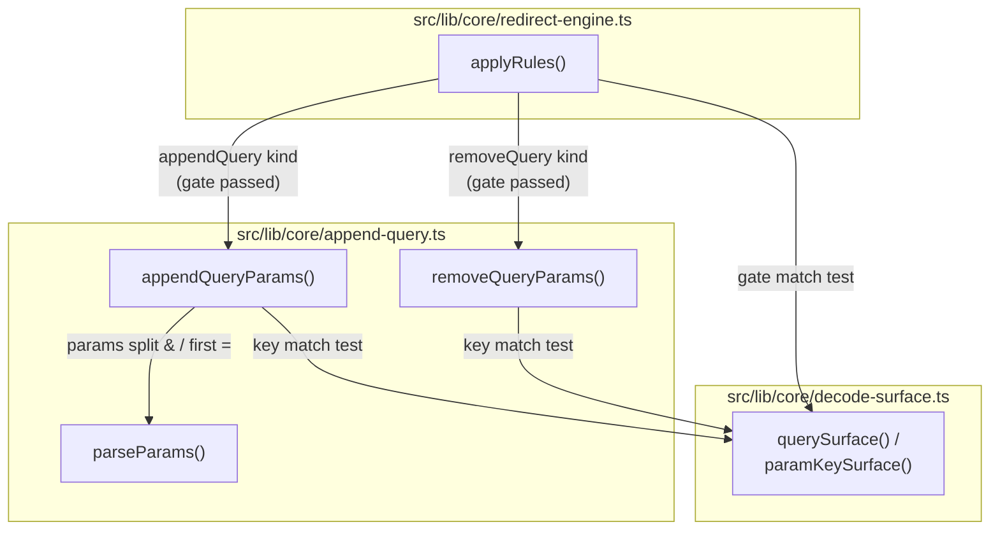
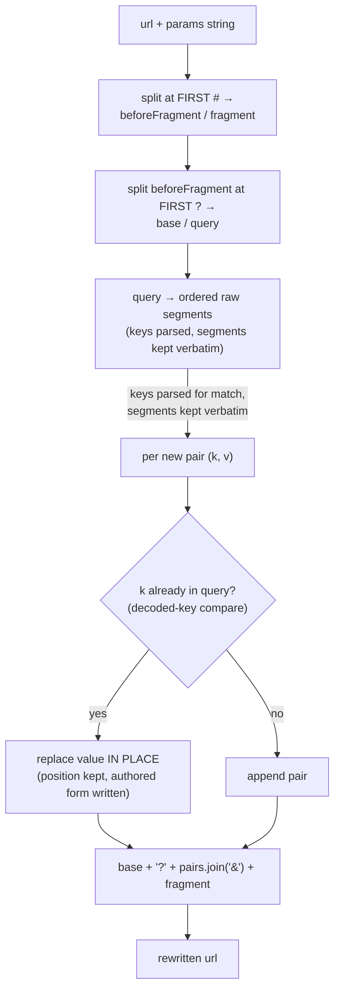
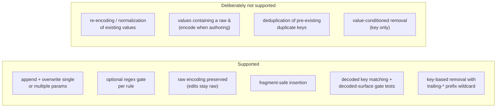

# Architecture: Query Append / Remove

> How the `appendQuery` rule kind merges query parameters and the `removeQuery` kind
> deletes them by key — without breaking fragments or raw encodings, and why matching
> happens on a decode-normalized surface while editing stays raw. Diagrams depict
> relationships, structure, and boundaries — no implementation details.

## Component Structure

Dedicated pure string surgery (ADR 0002) — the replacement for the legacy
`$&&base=1` substitution hack, which produced `page&base=1` (no `?`) and appended
after the `#fragment`:

## String-Surgery Decision Flow (`appendQueryParams`)

Pinned semantics (all covered by `append-query.test.ts` and the ported legacy corpus):

1. Separator: `?` when no query exists, `&` otherwise (the rebuild always emits
   exactly one `?`).
2. Existing key → value overwritten in place; only the FIRST occurrence is
   touched (later duplicates stay verbatim).
3. Fragment is never touched — params insert before the `#`; a `?` inside the
   fragment is fragment territory (first-`#` split wins).
4. Raw encodings survive: no `URLSearchParams`, no re-encoding (`+` stays `+`,
   `%20` stays `%20`, empty values stay empty). The EDITED string is always raw.
5. Params-string tolerance: segments without `=`, empty keys, and empty segments
   are skipped (logged at debug); a params string with no valid pair returns the
   url unchanged.
6. No `new URL()` anywhere — the legacy no-change corpus contains `ttp://…`,
   `ftp://…`, `user:pass@…` strings the URL constructor would reject.
7. Key MATCHING is decode-normalized (`paramKeySurface` in `decode-surface.ts`,
   28.10. fuq.com loop): escape-decoded with `+` read as space, compare-ONLY.
   A page-delivered `filter%5Bquality%5D=hd` collides with an authored
   `filter[quality]=x` — overwrite instead of duplicate. An overwrite writes the
   AUTHORED pair's form at the existing position (the params string stays the
   encoding lever). Invalid escapes (`%FF`) stay raw on both sides and still
   collide with themselves.
8. Literal `#` in an AUTHORED key or value is escaped to `%23` at serialize time
   — the one structurally unsafe character. An authored `%23` and every other
   raw form stay untouched; the pair object keeps the unescaped key for matching.

## Key-Based Removal (`removeQueryParams`)

`removeQuery` deletes query pairs whose key matches the authored `keys` list:

1. `keys` is `&`-separated. An exact segment matches one key; a trailing `*` is a
   prefix wildcard (`utm_*`); `*` alone matches every key and therefore clears the
   query.
2. Key matching uses `paramKeySurface` — the same decode-normalized surface as
   `appendQuery`; edits stay raw.
3. ALL matching pairs are removed, duplicates included; unmatched pairs are
   rebuilt verbatim.
4. The fragment is never touched. When the query becomes empty the `?` is dropped;
   when nothing matched, the url is returned unchanged.
5. No `new URL()`, no re-encoding, malformed input tolerated (bare `?flag`
   segments are treated as keys).

## Scope Boundaries

## References

- Implementation: `src/lib/core/append-query.ts`
- Decode surface: `src/lib/core/decode-surface.ts`
- Engine integration: `src/lib/core/redirect-engine.ts`
- Specs: `src/lib/core/__tests__/append-query.test.ts`, `src/lib/core/__tests__/decode-surface.test.ts`, `src/lib/core/__tests__/corpus.test.ts`
- Decisions: `docs/adr/0002-typed-rule-kinds.md`, `docs/adr/0044-remove-query-rule-kind.md`

Verified: 2026-11-09 — `appendQueryParams` and the new `removeQueryParams` against
`src/lib/core/append-query.ts` and its spec; decode surface and engine unchanged.
