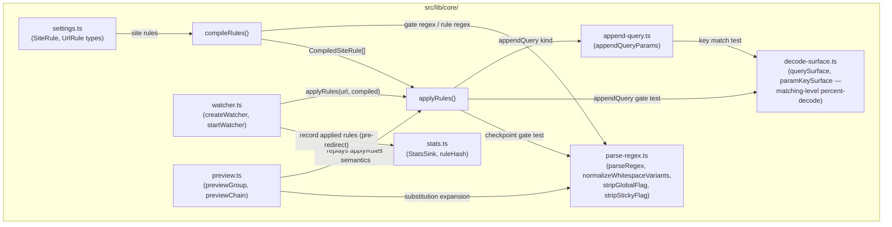
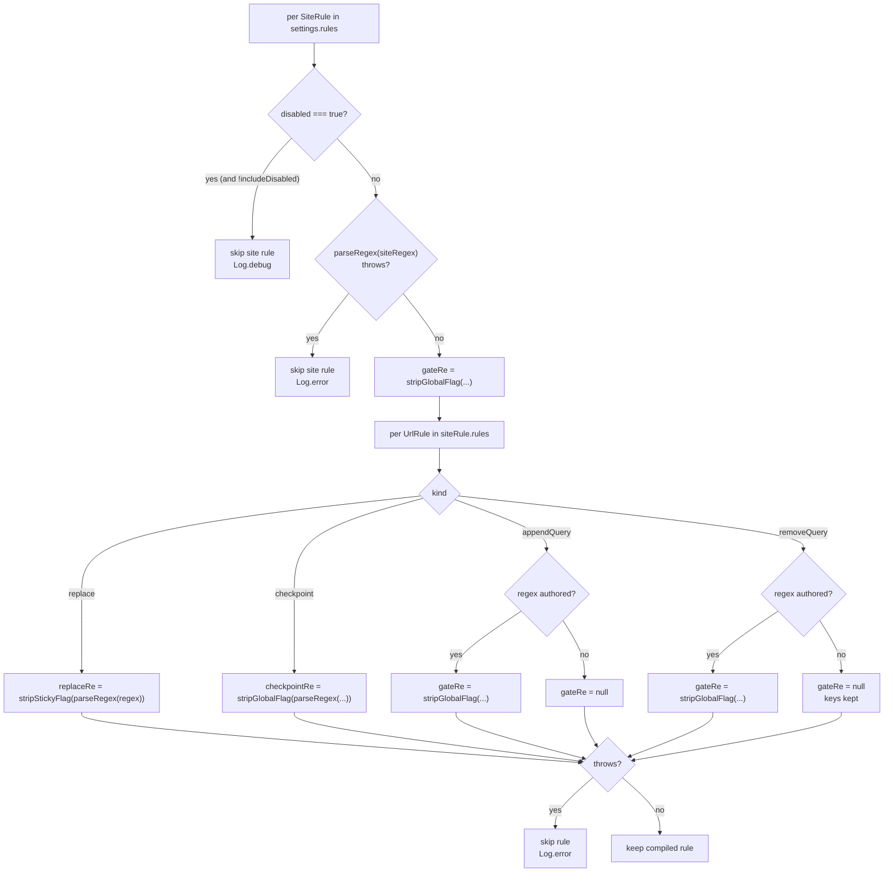
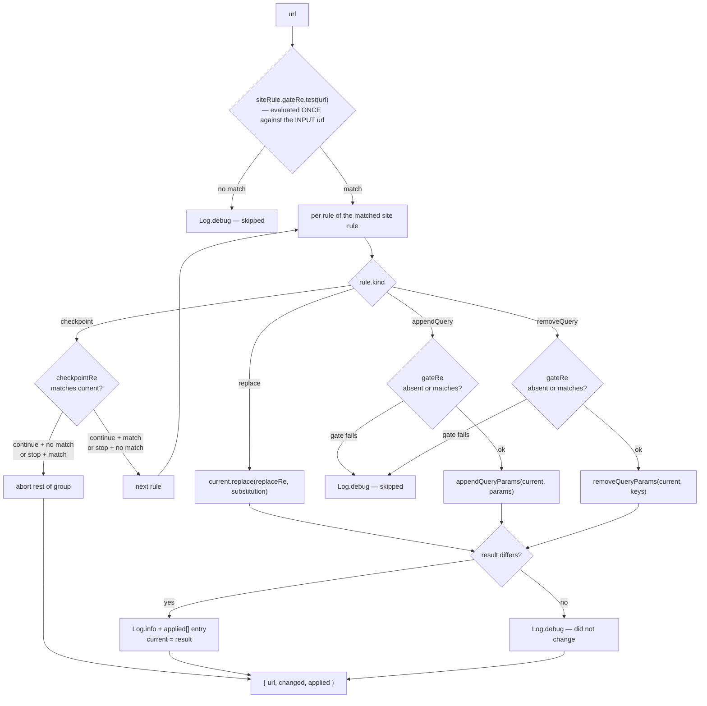
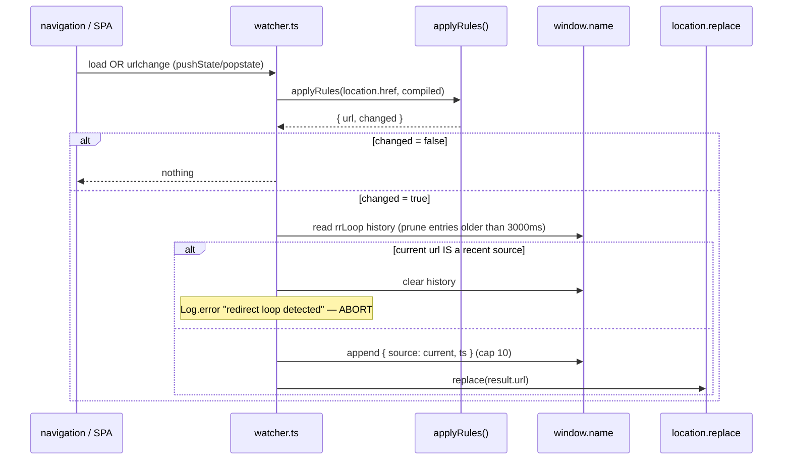
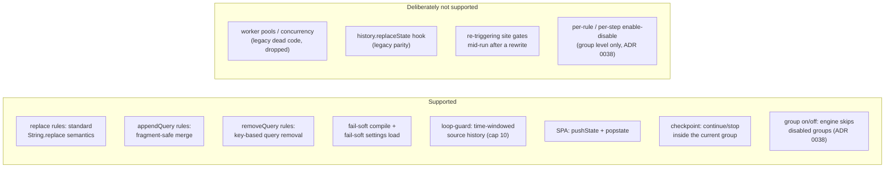

# Architecture: Redirect Engine

> How site rules are compiled and applied to a URL, and how the watcher turns a changed
> URL into a navigation. Diagrams depict relationships, structure, and boundaries — no
> implementation details.

## Component Structure

Pure transformation split from the side-effect layer (ADR 0001):

## Compilation — fail-soft (`compileRules`)

- Disabled groups (ADR 0038) are skipped at compile by default; `includeDisabled`
  exists only for the group-scoped preview (`previewGroup`), which must simulate
  an off group while the real engine ignores it.
- Gate regexes are stored global-stripped — a `g`-flagged `.test()` would leak
  `lastIndex` state across calls (a latent legacy bug, fixed in `parse-regex.ts`).
- `replace` rules strip the sticky `y` flag at compile (`stripStickyFlag`) but keep `g`
  (replace-all semantics). A sticky regex advances `lastIndex` across
  `String.replace` calls, which made consecutive runs non-deterministic; `g` alone stays
  supported.
- Invalid or unknown flags fall back to the LITERAL path: a string that does not match
  the accepted `/pattern/[dgimsuvy]*` notation is escaped and matched literally — it is
  never rejected as an invalid flag (known limitation, documented behavior).
- `checkpoint` regexes are global-stripped like gates. At run time the regex
  tests the CURRENT url; `continue` proceeds only on a match, `stop` aborts the
  rest of the group on a match (ADR 0019). A checkpoint never changes the URL.
- Empty `replace` and `checkpoint` regexes are dropped at compile (`Log.error`),
  so a hand-edited `stop` checkpoint cannot abort every redirect; an empty
  `appendQuery` or `removeQuery` gate still means "no gate".
- `removeQuery` removes every matching query pair by key: `keys` is
  `&`-separated, matched through `paramKeySurface`, and a trailing `*` is a
  prefix wildcard (`*` alone clears the query). Duplicates are all removed, the
  fragment is never touched, and an emptied query drops the `?` (ADR 0044).
- Whitespace normalization: `parseRegex` rewrites
  authored literal spaces and `\s` OUTSIDE character classes into the
  both-variants class `(?:%20|\s)` — `location.href` always carries `%20`, so
  whitespace-authored regexes could never match before. Inside character classes
  nothing is rewritten (users author `%20` there — documented in the
  rules-editor manual).
- Decoded gate surface (28.10., fuq.com loop): `appendQuery`/`removeQuery` gate
  regexes are tested against `querySurface(current)` — the query component's
  percent-escapes decoded (`filter%5Bquality%5D=` visible as `filter[quality]=`),
  `+` read as space, path/fragment raw. Motivation: gates and params strings are
  authored RAW while pages deliver keys percent-encoded; a raw-exact test appended
  duplicates until the page bounced back (A→B→A loop). The URL string itself is
  still never decoded for EDITS — `appendQueryParams`/`removeQueryParams` keep the
  raw-encoding contract intact; site gates stay tested against the raw url.
  Details: `docs/architecture/query-append.md` + `decode-surface.ts`.

## Application — pure single pass (`applyRules`)

- Legacy single-pass semantics: the site gates are evaluated once against the
  ORIGINAL url — a rewrite into another group's scope does not trigger that group
  in the same run (it applies on the next page load, after the redirect).
- Within a matched site rule, each rule sees the previous rule's result.
- The sequence lives in the pure `executeCompiledGroup(group, inputUrl, gateUrl)`
  executor (ADR 0017): it returns `{ gateMatched, steps, finalUrl, aborted }` with
  `ruleIndex` and one reason per step (`applied`, `unchanged`, `no-match`,
  `gate-no-match`, `checkpoint-continue`, `checkpoint-stopped`). `applyRules`,
  `previewChain`, and `previewGroup` consume it; preview only builds colored spans.
- `applyRules` records only changed non-checkpoint steps as `AppliedRule`.
  Checkpoints therefore never appear in the applied list or in stats counters.

## Watcher — the side-effect layer (`watcher.ts`)

- The guard keeps a time-windowed HISTORY of redirect sources — a single
  last-source marker cannot catch 2-cycles (A→B→A): on the third hop the marker
  would hold the OTHER page. Found by the E2E loop-guard spec (real A→B→A
  navigations — see testing.md), pinned by `watcher.test.ts` ("blocks 2-cycle
  oscillations").
- The history lives in `window.name`, NOT sessionStorage: sessionStorage is
  unavailable (throws) in pre-URL-commit contexts — Firefox at document-start —
  which silently disabled the guard until the E2E spec exposed it. `window.name`
  is synchronous at document-start and survives same-tab navigations; a foreign
  clobber self-heals to an empty history, so the guard stays armed.
- `createWatcher(compiled, runtime, sink?)` takes an injectable `WatcherRuntime`
  and an optional `StatsSink` — the loop-guard AND the stats recording are
  unit-testable without a browser (`watcher.test.ts`). The sink records applied
  rules AFTER the loop guard passes but BEFORE `location.replace`: the replace
  can synchronously trigger `beforeunload` persistence, so counters must already
  be in memory; loop-guard aborts count nothing.
- `installSpaHook` patches `history.pushState` ONCE per page and adds
  popstate + urlchange listeners; `Watcher.dispose` removes the listeners.

## Scope Boundaries

## Deviation from plan

The plan named the GUI reorder component "DraggableRow"; the first build shipped
`RowActions.svelte`. Pointer-drag reordering now exists, and the move-up/move-down
buttons were removed in favor of the drag path plus a delete/clone-only action strip
(always visible on site rows, hover/selection-revealed on rule rows) — see
[ADR 0031](../adr/0031-dashboard-interaction-model.md).

## References

- Engine: `src/lib/core/redirect-engine.ts`
- Watcher: `src/lib/core/watcher.ts`
- Regex parsing: `src/lib/core/parse-regex.ts`
- Decode surface (matching-level decode): `src/lib/core/decode-surface.ts`
- Preview model (engine-parity replays): `src/lib/core/preview.ts`
- Stats (redirect counters): `src/lib/core/stats.ts`
- Rule types: `src/lib/core/settings.ts`
- Specs: `src/lib/core/__tests__/redirect-engine.test.ts`, `src/lib/core/__tests__/watcher.test.ts`, `src/lib/core/__tests__/corpus.test.ts`, `src/lib/core/__tests__/preview.test.ts`, `src/lib/core/__tests__/stats.test.ts`, `src/lib/core/__tests__/decode-surface.test.ts`
- Query merge: `docs/architecture/query-append.md`
- Decisions: `docs/adr/0001-pure-engine-split.md`, `docs/adr/0017-shared-compiled-step-executor.md`, `docs/adr/0019-checkpoint-rule-kind.md`, `docs/adr/0038-per-group-enable-disable.md`, `docs/adr/0044-remove-query-rule-kind.md`

Verified: 2026-11-09 — removeQuery compile/execute branches, gates and query surgery against `redirect-engine.ts`/`append-query.ts`; replace sticky-flag stripping, window.name guard and stats ordering rechecked.
