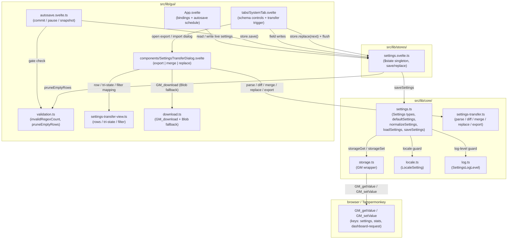
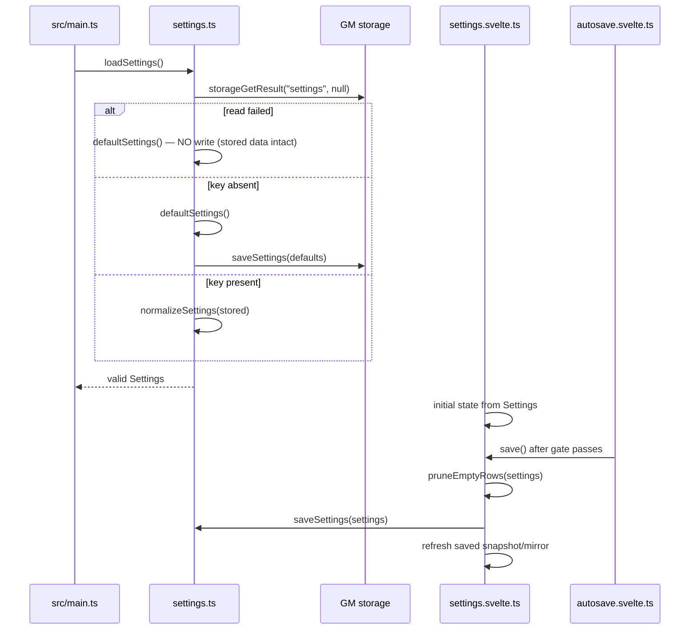
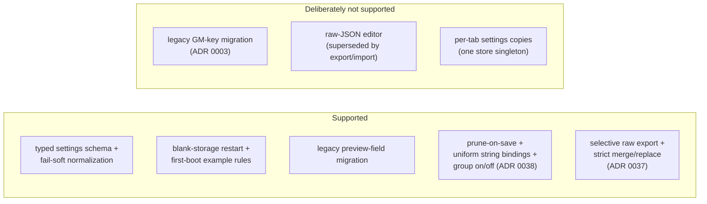

# Architecture: Settings & Storage

> The persisted settings schema, its fail-soft normalization, and the single store singleton that
> the dashboard binds to. Diagrams depict relationships, structure, and boundaries — no
> implementation details.

## Component Structure

## Schema

The persisted object under the `settings` key has this shape:

| Field             | Type / values                               | Role                                                                                                          |
| ----------------- | ------------------------------------------- | ------------------------------------------------------------------------------------------------------------- |
| `locale`          | `auto` \| `de` \| `en`                      | UI language; `auto` resolves from the browser                                                                 |
| `logLevel`        | settings log level union                    | Console verbosity; applied at boot                                                                            |
| `performanceMode` | boolean                                     | Stops stat recording + forces silent logging on new page loads; `logLevel` is preserved (ADR 0041)            |
| `theme`           | `auto` \| `dark` \| `light`                 | Dashboard theme (ADR 0013)                                                                                    |
| `motion`          | `aus` \| `schnell` \| `normal` \| `langsam` | CSS duration preset (ADR 0016)                                                                                |
| `hideSkipped`     | boolean                                     | Preview default: hide skipped chain steps; per-group overrides are session-only GUI state (ADR 0040)          |
| `dashboardHost`   | `fixed` \| `aboutblank`                     | Dashboard host selector (ADR 0012)                                                                            |
| `autosaveDelayMs` | number, normalized to 250–30000             | Autosave debounce; rail pill sets 1000/2000/5000, default 2000; legacy values stay valid (ADR 0020, ADR 0024) |
| `lastSelection`   | `{ siteIndex, ruleIndex }` optional         | Dashboard position restore; malformed entries dropped                                                         |
| `rules`           | `SiteRule[]`                                | Site groups with `previewEntries` and ordered rule kinds                                                      |

`SiteRule` carries `siteRegex`, an optional display-only `description` (absent/empty =
the readable site regex is shown), an optional sparse `disabled` flag (`true` = the
engine skips the group; absent = active), optional `previewEntries` (`url`,
`testOutputUri`, optional `description`), and ordered `UrlRule[]`. The rule kinds are
`replace`, `appendQuery`, `removeQuery`, `checkpoint`, and `unwrap` (ADR 0002, ADR 0019,
ADR 0044, ADR 0046); enable/disable is group-level only (ADR 0038).

`defaultLocked` is no longer part of the shape (ADR 0029): normalization only copies known
fields, so a stored value from an older profile is dropped silently on load — no migration.

Normalization enforces uniform strings for bound fields: `regex`, `substitution`, `params`, and
`siteRegex`-adjacent fields are always plain strings, `""` means unset. This is the Svelte 5
binding contract — `$bindable` props throw on `undefined`. The optional site `description` is
normalized to a trimmed string and omitted when empty/whitespace-only.

## Load / Normalize / Save

- **First boot only:** defaults are written only after a SUCCESSFUL read of an absent key;
  a failed read returns defaults WITHOUT writing, so an unreadable store is never overwritten
  with defaults. The legacy "rewrite storage on every load" behavior is not ported (ADR 0003).
- **Fail-soft normalization:** a corrupt top-level object degrades to defaults; malformed site
  rules and url rules are logged and skipped; unknown enum values keep the default. Boolean
  fields (`hideSkipped`, `performanceMode`) accept only booleans; missing/junk keeps `false`.
- **`lastSelection` bounds:** normalization accepts any non-negative integer pair but does not
  clamp it to the current rule list. The Rules tab validates the pair on mount (an out-of-range
  pair starts folded), and save drops the selection once it no longer resolves after pruning.
- **Stored rules replace the example list.** `EXAMPLE_RULES` is the first-boot default and is
  deep-copied so the module constant never leaks into the mutable store.
- **First-boot rules are real-world fixes:** twenty-seven groups (Wikipedia
  mobile→desktop, YouTube mobile/Shorts/embed/share with `si` cleanup, `youtu.be` short
  links, old/new/i/np.reddit→www.reddit, Reddit share params, Google search params +
  cleanup, Google AMP→canonical, Google Maps/Stack Overflow/Bing cleanup, DuckDuckGo/
  Yahoo/Google-Images `unwrap` wrappers, `redd.it` expansion, GitHub blob→raw,
  GitHub tree→blob for file paths, Gist→raw, Wikimedia Commons `File:`→original file,
  Amazon/Spotify/LinkedIn/Instagram/Facebook/TikTok/eBay cleanup, and tracking-param
  removal), each with pinned test entries, a use-case `description`, and a description
  on every preview entry. Site gates are anchored to `^https?://`, so share/redirect
  wrappers that merely contain a gated host stay untouched; the tracking group is the
  one content-gated exception and only edits query params. They ship DISABLED (opt-in,
  ADR 0038); existing stored groups without the flag stay active (no migration).
- **Disabled groups are inert for persistence:** their invalid/empty content does not block
  autosave, and prune-on-save keeps the group and its empty rules. The red invalid marker
  stays visible while authoring; the amber incomplete frame is suppressed while off.
- **Legacy preview migration:** a site-level `previewUrls` array and single-URL legacy preview
  entries (`testUrl`) are coerced into `previewEntries`; a rule-level `testUrl` is dropped, and
  malformed entries are skipped instead of rejecting the site.
- **Save:** the store prunes empty rows, reapplies selection indexes against object identity, and
  writes the whole settings object. The autosave gate pauses instead of pruning an incomplete
  row; import normalizes before assignment, so the store never holds an invalid shape.
- **Undo:** the persisted state at dashboard boot is the snapshot; restoring it commits
  immediately (ADR 0020).

## Transfer (Export / Import)

`src/lib/core/settings-transfer.ts` is the framework-free transfer core; the dialog
and store never re-implement its rules.

- **Export** builds a versioned envelope (`format: "redirect-rules-export"`,
  `version: 1`) from the selected fields, groups, rules, and group metadata. It
  writes the live values RAW — incomplete rows and invalid regexes are included
  and marked. `lastSelection` and `hideSkipped` are never exported (both are
  presentation/position state); `performanceMode` IS exported because it changes
  the boot behavior of every page context (ADR 0041). `partial` reflects selection
  coverage, not validity.
- **Import** parses the v1 envelope, the legacy `{ settings }` wrapper, and raw
  settings objects. It validates per unit without `normalizeSettings`; missing
  values mean "keep current". Unknown format/version, broken JSON, and unusable
  structure reject the whole file.
- **Matching** uses exact `siteRegex` with first-unused current groups, shared by
  `diffTransfer` and `applyMerge`. Merge replaces selected fields/metadata/rules
  by index, appends extra rules ascending, preserves unselected units, extra
  rows/groups, and `lastSelection`, and never prunes. The meta unit also carries
  the group `disabled` state (explicit boolean) so a backup restores both states.
- **Replace** is available only for a complete, fully valid file. It always sets
  `rules` explicitly (even `[]`) so normalization cannot restore the example
  rules; `lastSelection` is not restored, `hideSkipped` falls back to `false`, and
  `performanceMode` is taken from the file. Backups without the field are partial
  (merge only), by design.

## Storage Keys

- `settings` — the single settings object (`STORAGE_KEY`).
- `stats` — redirect counters, never exported with settings (`STORAGE_KEY_STATS`).
- `dashboard-request` — one boot request `{ id, url, createRule }`
  (`STORAGE_KEY_DASHBOARD_REQUEST`), consumed once by the new dashboard tab (ADR 0020).

## Scope Boundaries

## References

- Types, defaults, normalization: `src/lib/core/settings.ts`
- GM wrapper: `src/lib/core/storage.ts`
- Store singleton: `src/lib/stores/settings.svelte.ts`
- Save policy: `src/lib/gui/validation.ts`
- Autosave commit/pause: `src/lib/gui/autosave.svelte.ts`
- Settings tab: `src/lib/gui/tabs/SystemTab.svelte`
- Transfer core: `src/lib/core/settings-transfer.ts`
- Transfer UI: `src/lib/gui/settings-transfer-view.ts`,
  `src/lib/gui/components/SettingsTransferDialog.svelte`, `src/lib/gui/download.ts`
- Specs: `src/lib/core/__tests__/settings.test.ts`,
  `src/lib/core/__tests__/settings-store.test.ts`,
  `src/lib/core/__tests__/settings-transfer.test.ts`,
  `src/lib/gui/__tests__/autosave.test.ts`,
  `src/lib/gui/__tests__/settings-transfer-view.test.ts`
- Decisions: `docs/adr/0003-blank-storage-restart.md`,
  `docs/adr/0012-dashboard-host-stub.md`, `docs/adr/0013-manual-theme-toggle.md`,
  `docs/adr/0016-motion-and-animation-strategy.md`, `docs/adr/0019-checkpoint-rule-kind.md`,
  `docs/adr/0020-multi-dashboard-autosave.md`, `docs/adr/0031-dashboard-interaction-model.md`,
  `docs/adr/0037-settings-export-import-dialog.md`,
  `docs/adr/0038-per-group-enable-disable.md`, `docs/adr/0040-skipped-step-visibility-precedence.md`,
  `docs/adr/0041-performance-mode.md`, `docs/adr/0046-unwrap-rule-kind.md`
- Related docs: `docs/architecture/system-overview.md`, `docs/architecture/gui.md`

Verified: 2026-11-13 — against `settings.ts` load/normalize (read-failure guard, `lastSelection` bounds, twenty-seven example groups, `unwrap`) and the store save path.
