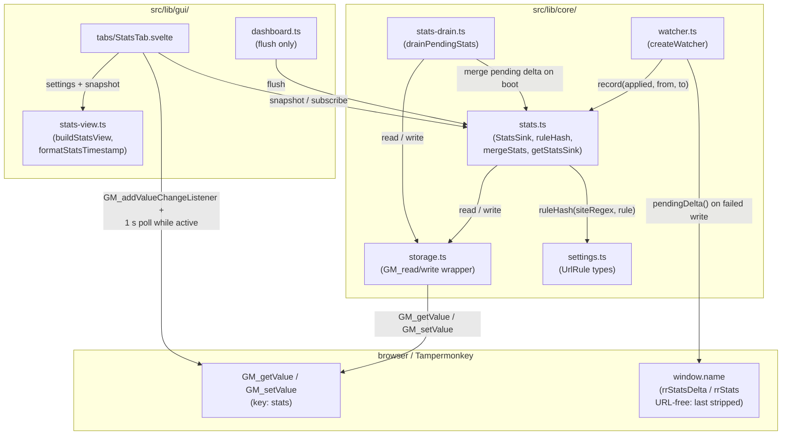
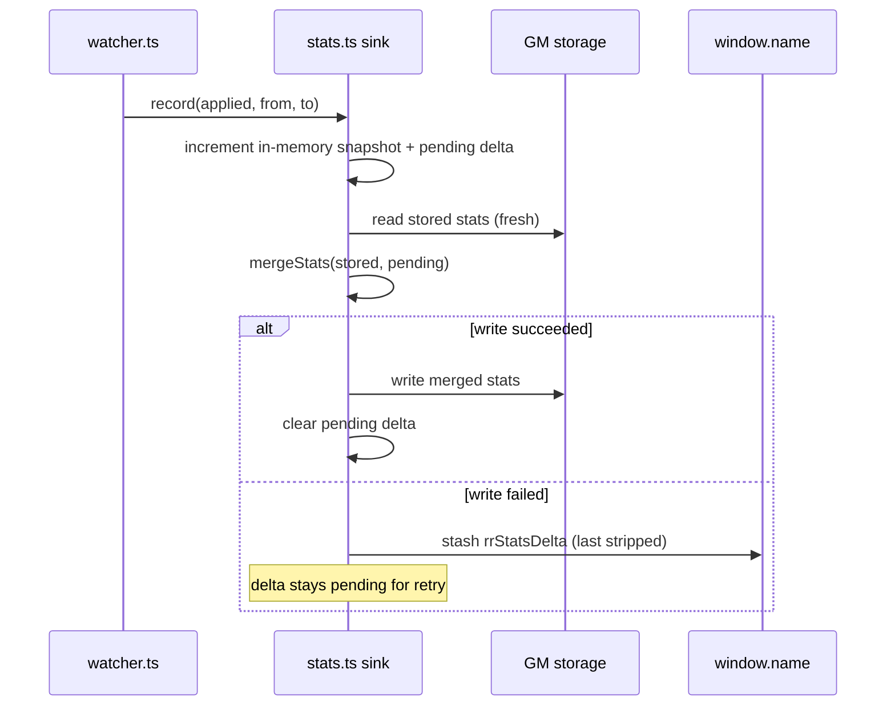
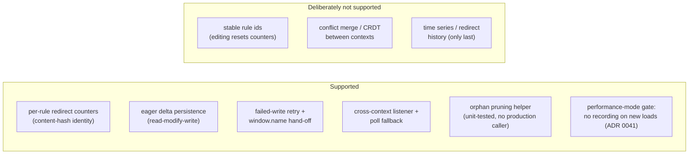

# Architecture: Stats

> Redirect counters persisted in a separate GM key, keyed by rule content and written as eager
> deltas so concurrent contexts cannot clobber newer counts. Diagrams depict relationships,
> structure, and boundaries — no implementation details.

## Component Structure

- The sink is a module singleton PER USERSCRIPT CONTEXT (`getStatsSink()`): the opener boot
  and the dashboard tab each instantiate their own module state, and they coordinate only
  through the shared `stats` GM key. Stats live under their own GM key, never inside the
  settings object — export/import never carries counters.
- Performance mode gates at the boot WIRING (ADR 0041): `src/main.ts` passes `undefined` to the
  watcher, so no sink is created, no per-redirect GM write happens, and the `window.name` delta
  stash is skipped. The sink semantics and storage shape are unchanged (the seed is additive).
- Identity is `ruleHash(siteRegex, rule)`: a stable content hash over the kind-specific tuple
  (`removeQuery` hashes `regex` + `keys`). Editing a rule changes its hash and therefore
  resets its counter; duplicate rules collide by design. There are no persisted rule ids.
- The hash includes `checkpoint` rules, but a checkpoint never changes the URL. `applyRules`
  records only changed non-checkpoint steps, so a checkpoint row renders with a counter of `0`.

## Persistence — eager delta

- Every recorded redirect persists eagerly, but only as a **delta against a fresh read**
  (read-modify-write). A stale in-memory snapshot cannot overwrite counts recorded by another
  context.
- A failed read is NOT empty storage: the sink keeps the delta pending instead of merging it
  into an empty base (which would erase stored counters). A failed write keeps the delta pending
  as well; `flush()` retries it and returns `"idle" | "persisted" | "failed"`. The watcher also
  stashes the pending delta in `window.name` before a redirect, so a truncated document can hand
  it to the next boot.
- The `window.name` stash is URL-free: it carries counts/total only and always writes `last:
null` (`last.from`/`to` are raw page URLs). A failed-write recovery therefore loses only the
  last-redirect display, never page URLs. Failed-read/failed-write paths also strip a legacy
  `last` before leaving the stash in place.
- `beforeunload` (opener window) clears ONLY the `rrStatsDelta` stash after a `"persisted"`
  flush; `idle` and `failed` keep the stash. `clearStatsDeltaStash()` deletes just that field and
  preserves every other `window.name` key.
- `drainPendingStats()` lives in `src/lib/core/stats-drain.ts` and runs at document-start before
  the watcher: it merges `rrStatsDelta` into storage, or adopts a legacy full `rrStats` snapshot
  only when storage is TRULY empty (`total === 0`, no counts, `last === null`). It returns the
  normalized un-drained delta when a failed read/write keeps the stash; `src/main.ts` passes it
  as the sink `seed`, so a later redirect cannot overwrite and lose the recovered counters. A
  legacy full snapshot is NEVER returned as a delta (that would double-count); a failed drain
  with only `rrStats` returns `null` and keeps the stash. It stays unconditional under
  performance mode — recovering an already-stashed delta is not a recording write (ADR 0041).
  The module is unit covered by `stats-drain.test.ts`.
- `normalizeStats` is fail-soft: corrupt storage degrades to empty stats, invalid counters are
  dropped, and the `last` record is accepted only with the full `{ from, to, ts }` shape. Known
  gap: `total` and each counter accept any finite number `>= 0` — they are not integer-checked,
  so a hand-edited fractional or very large value survives normalization.
- `prune(keep)` drops counters whose hashes no longer exist in the settings rule list. It has
  NO production caller: the dashboard deliberately flushes without pruning because orphaned
  counters are harmless; the function stays unit-tested only.

## Rendering — cross-context

- `StatsTab` subscribes to the sink's in-memory changes and also listens to
  `GM_addValueChangeListener` for remote stats writes. A 1 s poll is the fallback for
  environments where value-change events are delayed or absent between contexts; it runs only
  while the Stats tab is active (the panel stays mounted after the first visit) and refreshes
  once immediately on activation. The sink subscription stays mounted.
- The tab renders the S3 insight layout. The hero shows the all-time redirect total as the
  dominant number, `Sites` / `Active rules` fact chips, and a kind donut whose center shows
  `appliedTotal` (summed applied-rule hits) and whose legend lists the fixed order
  `replace`, `appendQuery`, `removeQuery`, `checkpoint` with counts and shares.
- `stats.total` counts redirects while `appliedTotal` counts applied rule hits. One redirect
  can apply several rules in a chain, so `appliedTotal` may exceed `stats.total`; every
  percentage (kind, top rule, site, footer) uses `appliedTotal` as denominator.
- The last-redirect card reuses the Rules-tab URL field surface: a `.rr-preview-grid` with
  `From`/`To` labels outside `.rr-preview-panel`s and URI-component coloring from
  `splitUrlComponents()`. It remains a single record, not a history.
- `Top rules` ranks active rules (count > 0) by count, then name, site label, source index,
  and chain position; the component slices to six. `Rule groups` keeps the description-first
  `siteCaption` bars and adds a footer (largest group, Ø per rule, no hits). The two cards
  share one grid row height.
- The only fold is the rules-by-group accordion; it starts closed. Every configured rule
  stays visible and rules keep chain order with a 1-based position chip, a kind chip, and a
  readable label (replace: `regex → substitution`; append: params with the readable gate
  below; checkpoint: readable regex with the localized mode below). Zero-count rows are
  dimmed. Raw regex/params/mode text is confined to tooltips.
- `buildStatsView(settings.rules, stats, locale)` in `stats-view.ts` is pure and derived on
  every settings/counter/locale change. Groups and sites sort by count descending, then
  label, then numeric source index; duplicate rules stay separate rows (one counter per
  content hash).
- The tab body owns the scroll. Bar width transitions use the shared motion tokens and
  respect `prefers-reduced-motion` (ADR 0016).
- While performance mode is on, a warning-toned banner above the hero explains that new page loads
  stop counting while already-open pages keep counting until reload, and links to the Settings
  tab. Existing counters stay rendered and are never cleared or hidden; the banner exists so a
  frozen value does not look like a defect (ADR 0041).

## Scope Boundaries

The eager delta read-modify-write closes the normal concurrent-context race, but two
contexts recording in the same microtask window can still lose one delta. The window is
tiny and the impact is cosmetic (counter telemetry), so no CRDT/locking layer is added.

## References

- Sink + identity: `src/lib/core/stats.ts`
- Storage keys: `src/lib/core/storage.ts`
- Recording side effect: `src/lib/core/watcher.ts`
- Boot drain: `src/lib/core/stats-drain.ts` (called from `src/main.ts`)
- Dashboard lifecycle: `src/lib/gui/dashboard.ts`
- Rendering: `src/lib/gui/tabs/StatsTab.svelte` + `src/lib/gui/stats-view.ts`
- Decision: `docs/adr/archive/0027-stats-tab-hero-and-cards.md`; performance-mode gate and
  banner in `docs/adr/0041-performance-mode.md`
- Specs: `src/lib/core/__tests__/stats.test.ts`,
  `src/lib/core/__tests__/watcher.test.ts`, `src/lib/core/__tests__/stats-drain.test.ts`,
  `src/lib/gui/__tests__/stats-view.test.ts`
- Related docs: `docs/architecture/system-overview.md`, `docs/architecture/gui.md`

Verified: 2026-11-09 — against `stats.ts` (seed, read-failure/flush contract, per-context singleton, integer-validation gap) and `stats-drain.ts` (un-drained delta return, URL-free stash, truly-empty legacy adoption).
