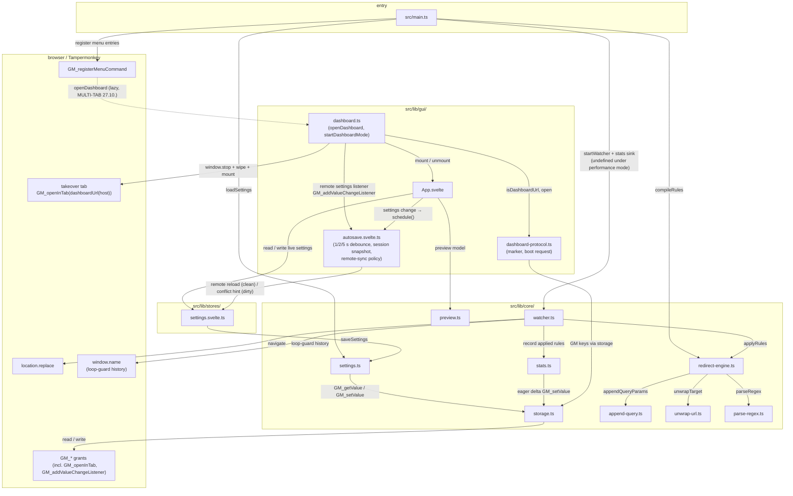

# Architecture: System Overview

> What the Redirect Rules userscript consists of, how it boots, and which layers talk
> to each other. Diagrams depict relationships, structure, and boundaries — no
> implementation details.

## Layers

The codebase has two clearly separated concerns, mirroring the youtube-ui-tweaks split:

1. **Core** (`src/lib/core/`): framework-free URL rewriting — rule compilation, the pure
   apply engine, query-parameter surgery, GM storage, logging — plus exactly ONE
   side-effect layer (`watcher.ts`): pushState/popstate listeners and the single
   `location.replace` call site (ADR 0001). The logging contract is documented in
   [logging.md](logging.md).
2. **GUI** (`src/lib/gui/`): the Svelte 5 dashboard (master-detail rules editor,
   system settings, about) as a HASH-TAKEOVER page (ADR 0011): a new tab opened via
   `GM_openInTab` with the `#rr-dashboard` marker, taken over by the userscript at
   document-start. Never mounted at `@run-at document-start` on normal pages.



## Boot Sequence (`src/main.ts`)

Runs at `@run-at document-start` on every page (`*://*/*`):

```mermaid
sequenceDiagram
    participant TM as Tampermonkey
    participant Main as src/main.ts
    participant Set as settings.ts
    participant Eng as redirect-engine.ts
    participant D as stats-drain.ts
    participant W as watcher.ts
    participant St as stats.ts
    participant Menu as GM menu

    TM->>Main: document-start
    Main->>Set: loadSettings()
    Note over Set: key absent + read ok → write defaults;<br/>read failed → defaults WITHOUT writing; corrupt → defaults + Log.error
    Main->>Set: setLogLevel(effectiveLogLevel(settings))
    Note over Main: performance mode → silent without overwriting stored logLevel
    Main->>D: drainPendingStats()
    Note over D: merge rrStatsDelta from window.name;<br/>failed read keeps the stash
    Main->>Eng: compileRules(settings.rules)
    Note over Eng: fail-soft — invalid regex skips THAT rule (Log.error)
    Main->>St: getStatsSink() — only when performance mode is OFF
    Main->>W: startWatcher(compiled, sink?)
    W->>W: run(location.href) — initial pass
    Note over W: changed → loop-guard check → location.replace
    W-->>St: sink.record(applied, from, to) — BEFORE location.replace
    W-->>W: installSpaHook — pushState patch + popstate listener
    Main->>Menu: register "Open Dashboard" / "Create new Rule" (locale-aware)
    Note over Menu,Main: dev build only (build:dev, __DEV__): debug-log toggle +<br/>settings reset entries — dead-code-eliminated in prod
    Menu-->>Main: user click (post-load)
    Note over Main,Menu: openDashboard → boot request value →<br/>GM_openInTab(dashboardUrl(host))<br/>— MULTI-DASHBOARD (27.10.): every click opens its own tab
    Main-->>TM: the new tab's userscript instance boots in DASHBOARD MODE<br/>(window.stop + DOM wipe + fullscreen mount — ADR 0011)
```

Provisional `about:blank` documents defer the boot: a newly opened tab or webview can
still read `about:blank` at document-start because its real URL commits later. `main.ts`
polls the URL every 5 ms for at most 2000 ms, then boots normally. Tampermonkey injects
into the committed document and never takes this path; it serves non-TM injection
environments (e.g. Playwright) and a never-navigating provisional tab boots in normal
mode on `about:blank`.

## Fail-Soft Chain

Every storage/regex failure degrades instead of crashing the boot:

- Invalid rule regex → rule skipped, rest of the ruleset keeps working
  (`redirect-engine.ts` `compileRules`).
- Corrupt stored settings → defaults + `Log.error` (`settings.ts`
  `normalizeSettings`).
- Corrupt stored stats → empty stats (`stats.ts` `normalizeStats`).
- Corrupt dashboard boot requests → no-op (`dashboard-protocol.ts`
  `normalizeRequest`).
- `window.name` clobbered by a foreign script → READS treat a non-object/invalid
  payload as an empty state, so the guard stays armed with an empty history;
  WRITES PRESERVE a valid JSON object (foreign keys spread through) and replace
  only non-JSON/primitive/array payloads (deliberate destructive trade-off where
  it applies — the guard must persist; `watcher.ts` `browserRuntime` self-heal).
- Performance mode enabled → no stats sink for the watcher (no GM write, no
  `window.name` stash) and effective `silent` logging; a pending delta from an
  earlier failed write is still drained at boot (ADR 0041).

## References

- Boot: `src/main.ts`
- Core modules: `src/lib/core/settings.ts`, `src/lib/core/redirect-engine.ts`, `src/lib/core/decode-surface.ts`, `src/lib/core/unwrap-url.ts`, `src/lib/core/watcher.ts`, `src/lib/core/stats.ts`
- Store: `src/lib/stores/settings.svelte.ts`
- Dashboard orchestration: `src/lib/gui/dashboard.ts`, `src/lib/gui/dashboard-protocol.ts`, `src/lib/gui/autosave.svelte.ts`, `src/lib/gui/autosave-speed.ts`
- Decisions: `docs/adr/0001-pure-engine-split.md`, `docs/adr/0003-blank-storage-restart.md`, `docs/adr/archive/0010-dashboard-about-blank-tab.md`, `docs/adr/0011-dashboard-hash-takeover.md`, `docs/adr/0012-dashboard-host-stub.md`, `docs/adr/0019-checkpoint-rule-kind.md`, `docs/adr/0020-multi-dashboard-autosave.md`, `docs/adr/0031-dashboard-interaction-model.md`, `docs/adr/0041-performance-mode.md`, `docs/adr/0046-unwrap-rule-kind.md`
- Logging: `src/lib/core/log.ts`, `docs/architecture/logging.md`
- Component docs: `docs/architecture/redirect-engine.md`, `docs/architecture/query-append.md`, `docs/architecture/settings-storage.md`, `docs/architecture/stats.md`, `docs/architecture/gui.md`, `docs/architecture/dashboard-protocol.md`, `docs/architecture/testing.md`, `docs/architecture/logging.md`

Verified: 2026-11-13 — against `src/main.ts` (boot + drain), `settings.ts` load semantics, `stats-drain.ts`, `unwrap-url.ts`, and `watcher.ts` window.name read/write behavior.
