# Architecture: Testing

> How the system is verified at each layer. Diagrams depict relationships, structure, and
> boundaries — no implementation details.

## Layers

```mermaid
flowchart TB
    subgraph Sources["src/lib/core/ + src/lib/gui/"]
        Engine["redirect-engine.ts"]
        Append["append-query.ts"]
        Watcher["watcher.ts"]
        Settings["settings.ts"]
        Preview["preview.ts"]
        Stats["stats.ts"]
    end
    subgraph Unit["Layer 1 — Vitest (node)"]
        U1["parse-regex.test.ts<br/>(incl. whitespace normalization)"]
        U2["append-query.test.ts"]
        U3["redirect-engine.test.ts"]
        U4["settings.test.ts"]
        U5["locale.test.ts"]
        U6["corpus.test.ts<br/>(~115 ported legacy cases)"]
        U7["preview.test.ts<br/>(applyRules parity +<br/>expandSubstitution corpus)"]
        U8["stats.test.ts<br/>(hash, sink, pruning)"]
        Stubs["gm-stubs.ts<br/>(in-memory GM_*)"]
    end
    subgraph Integration["Layer 2 — Vitest (jsdom)"]
        I1["watcher.test.ts<br/>(fake runtime + real history<br/>+ stats sink)"]
        I2["settings-store.test.ts<br/>(store singleton)"]
    end
    subgraph E2E["Layer 3 — Playwright (Firefox)"]
        E1["e2e/tests/*.spec.ts"]
        Helpers["e2e/helpers/<br/>(fixture-server, gm-polyfill, userscript)"]
        Dist["dist/redirect-rules.user.js"]
    end
    subgraph Browser["browser"]
        FF["Firefox"]
        Fixtures["synthetic fixture pages<br/>(e2e/helpers/fixture-server.ts,<br/>port 4184 default, RR_FIXTURE_PORT override)"]
    end

    U1 --> Engine
    U2 --> Append
    U3 --> Engine
    U4 --> Settings
    U6 --> Engine
    U7 --> Preview
    U4 -.-> Stubs
    U8 --> Stats
    U8 -.-> Stubs
    I1 --> Watcher
    I2 --> Settings
    E1 --> Helpers
    Helpers -.->|"injects"| Dist
    Helpers -.->|"serves"| Fixtures
    E1 -->|"runs against"| FF
```

## Layer Contracts

- **Unit (node env)**: pure functions only — regex parsing, the apply engine,
  append-query surgery, settings normalization, locale detection (stubbed
  `navigator`). GM globals are in-memory stubs (`gm-stubs.ts`), installed at call
  time (the storage module resolves them lazily; clone-on-write via JSON
  round-trip — $state proxies reject structuredClone, and a stored reference
  would leak store mutations into "persisted" reads).
- **Integration (jsdom env)**: the watcher's loop-guard runs against an
  injectable `WatcherRuntime` with a fake location/session map, while the
  pushState-patch test uses the REAL jsdom `history` + `location`; the store
  singleton tests cover CRUD, dirty tracking, and prune-on-save; the autosave
  singleton tests cover the configured debounce (fake timers), the pause gates
  (invalid regex / empty rows never persist), the synchronous close flush, the
  session snapshot (undo, available AFTER commits), and the remote-sync policy
  (adoption while clean, conflict hint while dirty). The pure speed mapping
  (nearest/next canonical delay) lives in a node unit test. jsdom's
  `location.replace` is not implemented — the fake runtime never touches it.
- **E2E (Firefox, in CI)**: the built userscript + GM polyfill are injected via
  CONTEXT-scoped `addInitScript` (document-start parity — this boot reads no
  `documentElement`; popups created by `window.open`/`GM_openInTab` would NOT get
  page-scoped init scripts) so redirects are REAL navigations. Committed synthetic
  fixtures (ADR 0004) make the suite CI-eligible, unlike the youtube-ui-tweaks
  capture pipeline. Specs run the PROD artifact; the dev build writes a distinct
  `redirect-rules.dev.user.js` so a dev run can never silently test the prod bundle
  (helper param `dev`).
- **Dashboard takeover tests** (ADR 0011, MULTI-DASHBOARD 27.10.): the takeover tab
  is window.open'ed — its init scripts run on the PROVISIONAL about:blank document
  (location still reads "about:blank"), which the boot defers until the url commits;
  `window.stop()` aborts the load, so the `load` event NEVER fires on the dashboard
  tab — specs wait for the dashboard selector instead. The polyfill backs
  `GM_openInTab` with `window.open` (Playwright does not popup-block — real browsers
  do, which is WHY production uses GM_openInTab) and `GM_addValueChangeListener`
  with localStorage storage events (dashboard tabs + opener share the fixture
  origin); polyfill reads prefer localStorage over the baked seed so a
  LATER-OPENED dashboard boots with the CURRENT values (Tampermonkey parity).
  The smoke spec covers the autosave round-trip (configured debounce → storage
  mirror), the speed pill/countdown ring, the synchronous close flush, the
  SECOND-tab create-rule prefill, the two-tab remote sync, and the undo restore
  (session snapshot; the restore confirm
  needs an explicit `dialog` accept — Playwright auto-dismisses native modals).
- **E2E harness**: the fixture server port defaults to 4184 and honors `RR_FIXTURE_PORT`
  (invalid values fail fast); `globalSetup` starts the server, exports the resolved port, and
  returns its teardown, while `globalTeardown` calls the same idempotent stop as a fallback.
  `blockFontRequests()` in the helper layer aborts `**cdn.jsdelivr.net/**` at CONTEXT scope
  (idempotently, from `injectUserscript`/`openDashboardTab`), so neither a page nor the dashboard
  popup reaches the live font CDN. Positive events are awaited with `expect.poll`; fixed sleeps
  remain only where no positive event exists (the `no-match` settle window, popover
  light-dismiss holds, and the popup-discovery poll).
- **Corpus**: `corpus.test.ts` ports the legacy in-browser `runUnitTest` sample
  set — ~75 no-change URLs + ~40 expected changes — with three documented
  expectation fixes (rule-4 notation, rule-6 trailing slash, rule-12 fragment
  case), each noted in the file header.
- **Preview parity**: `preview.test.ts` pins `previewGroup` (the group's full
  chain — every authored rule, applied or skipped) and the full-settings
  `previewChain` oracle against `applyRules` outputs, plus
  `expandSubstitution` against native `String.replace` (tricky-template corpus:
  `$$`, `` $` ``, `$'`, `$10`, `$<name>`), the whitespace-variant authoring
  cases (plan W2), and per-step reasons/applied-skipped statuses.
- **Executor + checkpoints**: `redirect-engine.test.ts` pins the shared
  `executeCompiledGroup` contract (`ruleIndex`, gateUrl vs inputUrl,
  no-match/gate-no-match/checkpoint-stopped) and checkpoint semantics — stripped
  gate flags, `continue`/`stop` abort, empty-regex dropped at compile (mirrors
  the empty-`replace` policy), no `AppliedRule` entries, and group-local abort.
  `preview.test.ts` pins the corresponding `checkpoint-continue` /
  `checkpoint-stopped` reasons.
- **Stats**: `stats.test.ts` covers the rule content hash (stability, cross-group
  distinction), fail-soft normalization, eager delta persistence (read-modify-write,
  failed-write retry), and orphan pruning; the watcher integration asserts
  pre-redirect recording (before `location.replace`) + loop-abort non-recording.
- **Performance mode (ADR 0041)**: `settings.test.ts` pins boolean normalization
  and the `effectiveLogLevel` matrix; `settings-transfer.test.ts` pins the field's
  export/merge/replace contract and strict boolean parsing;
  `e2e/tests/performance-mode.spec.ts` proves a redirect still happens with no
  stats write, the toggle locks/unlocks the log level and persists both states,
  a normal redirect still records (over-gating guard), and the Stats banner hands
  off to Settings.
- **Group on/off (ADR 0038)**: `redirect-engine.test.ts` pins the compile-time skip
  and the `includeDisabled` preview exception; `preview.test.ts` pins the disabled
  simulation and the `previewChain`/`applyRules` parity; `validation.test.ts` and
  `autosave.test.ts` pin the inert gate/prune behavior; `settings-transfer.test.ts`
  pins the backup round-trip. `e2e/tests/group-enable.spec.ts` drives disable →
  no redirect → re-enable → redirect through the real dashboard.

## Loop-Guard Coverage Split

- Unit-level: window/staleness/corruption/2-cycle decisions in `watcher.test.ts`
  (deterministic fake clock — the 2-cycle case is the single-marker blind spot
  the E2E run exposed).
- E2E-level: `e2e/tests/loop-guard.spec.ts` drives the real A→B→A navigation
  oscillation. Its loop rules live in TWO site groups — a single group applies
  A→B and B→A in one engine pass and collapses back to the original url. The
  spec asserts the navigation sequence, a stable settled page, and the cleared
  `window.name` history (`rrLoop: []`); it does not depend on console capture.
- The former `test.fixme` was not a guard defect: the shared seed's two loop
  rules cancelled inside one pass, so no redirect ever occurred.

## Manual (not automated)

- Tampermonkey install + real-world rule sets + the dashboard's remaining
  unsaved-changes dialogs (the confirm only fires while the autosave gate
  PAUSES — invalid regex / empty row; `beforeunload` on tab close — native
  modals, auto-dismissed in Playwright).
- The hash-takeover on real pages (site flash/wipe on strict-CSP + busy pages,
  the multi-tab autosave conflicts on a real profile, `window.close()` refusal
  fallback, popup-blocker path for the non-TM `window.open` fallback) —
  ADR 0011 risks.

## References

- Unit specs: `src/lib/core/__tests__/parse-regex.test.ts`, `src/lib/core/__tests__/append-query.test.ts`, `src/lib/core/__tests__/decode-surface.test.ts`, `src/lib/core/__tests__/redirect-engine.test.ts`, `src/lib/core/__tests__/settings.test.ts`, `src/lib/core/__tests__/locale.test.ts`, `src/lib/core/__tests__/corpus.test.ts`, `src/lib/core/__tests__/preview.test.ts`, `src/lib/core/__tests__/stats.test.ts`, `src/lib/core/__tests__/storage.test.ts`, `src/lib/core/__tests__/chat-template.test.ts`, `src/lib/core/__tests__/settings-diff.test.ts`, `src/lib/core/__tests__/encoding.test.ts`, `src/lib/gui/__tests__/dashboard-protocol.test.ts`, `src/lib/gui/__tests__/i18n-parity.test.ts`, `src/lib/gui/__tests__/i18n-usage.test.ts`, `src/lib/gui/__tests__/motion.test.ts`, `src/lib/gui/__tests__/drag-controller.test.ts`
- Integration specs: `src/lib/core/__tests__/watcher.test.ts`, `src/lib/core/__tests__/stats-drain.test.ts`, `src/lib/core/__tests__/settings-store.test.ts`, `src/lib/gui/__tests__/autosave.test.ts`
- E2E: `e2e/tests/redirect-on-load.spec.ts`, `e2e/tests/no-match.spec.ts`, `e2e/tests/spa-navigation.spec.ts`, `e2e/tests/append-query.spec.ts`, `e2e/tests/loop-guard.spec.ts`, `e2e/tests/dashboard-smoke.spec.ts`, `e2e/tests/group-enable.spec.ts`, `e2e/tests/toast-undo.spec.ts`, `e2e/tests/performance-mode.spec.ts`
- E2E helpers: `e2e/helpers/fixture-server.ts`, `e2e/helpers/gm-polyfill.ts`, `e2e/helpers/userscript.ts`, `e2e/helpers/dashboard.ts`
- CI wiring: `.github/workflows/ci.yml`
- Decisions: `docs/adr/0004-synthetic-e2e-in-ci.md`, `docs/adr/0011-dashboard-hash-takeover.md`, `docs/adr/0012-dashboard-host-stub.md`, `docs/adr/0020-multi-dashboard-autosave.md`, `docs/adr/0031-dashboard-interaction-model.md`

Verified: 2026-11-09 — against `e2e/` (RR_FIXTURE_PORT, returned globalSetup teardown, jsDelivr abort, remaining fixed sleeps) and the current spec inventory.
